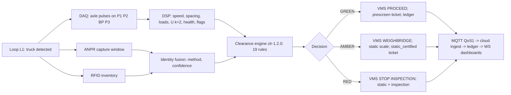
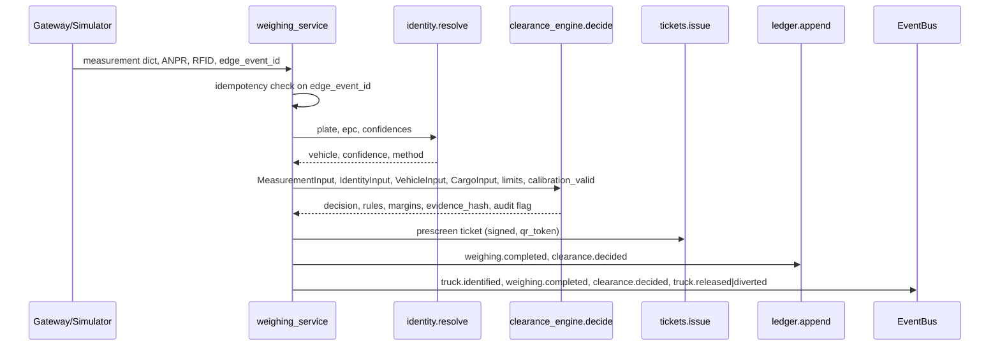
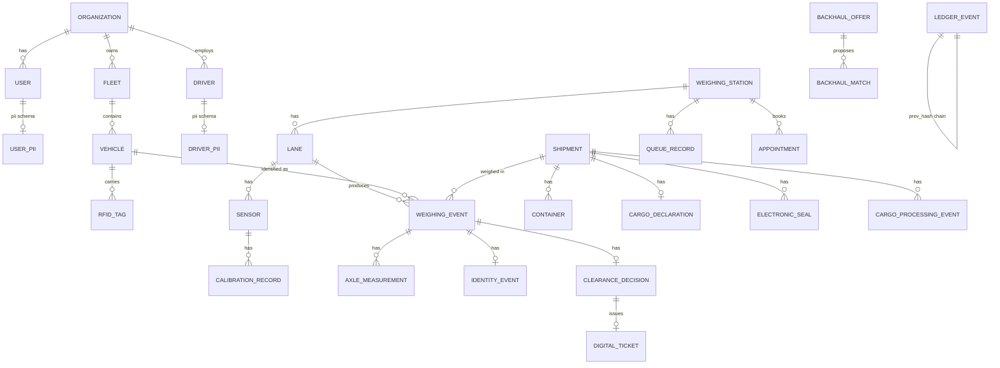
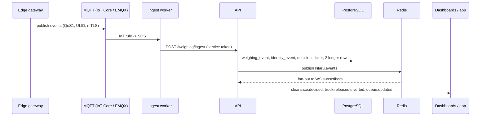
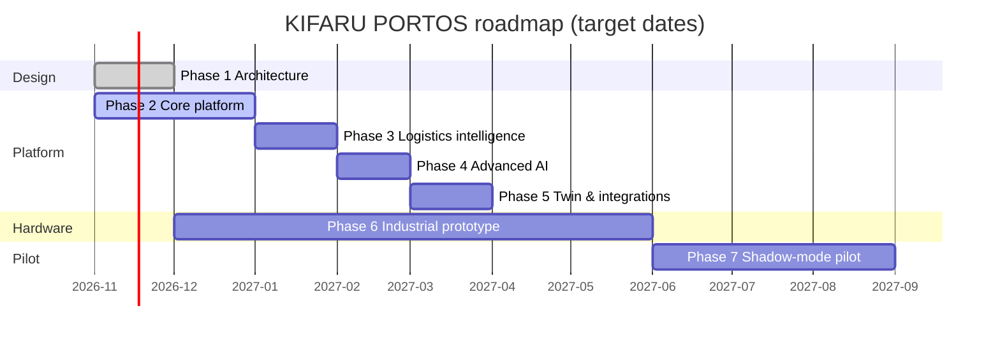

# 1. Title Page

**KIFARU PORTOS**
**Kenya Intelligent Freight, Access, Routing & Unified Logistics Platform**

*A smart-port weigh-in-motion rolling-clearance ecosystem for the Port of Mombasa, the Mariakani weighbridge and the Northern Corridor*

**Engineering Report — Phase 1–2 baseline (design, prototype software, test evidence)**

| Field | Value |
|---|---|
| Document | `docs/05-report/KIFARU-PORTOS-Engineering-Report.md` |
| Version | 0.1 (draft) |
| Date | 2026-11-04 |
| Prepared by | KIFARU PORTOS engineering team (architecture, backend, DSP, AI, hardware, cloud, mobile, security, documentation workstreams) |
| Prepared for | Project owner; prospective regulator reviewers (KeNHA, KPA, KRA, NTSA); academic examiners |
| Repository | `kifaru-portos/` monorepo (this report cites files by path) |
| Status of the original proposal | The original *Rolling Clearance System* document was **not available**; the baseline was reconstructed from the Master Prompt (`docs/01-requirements/00-source-review.md`) |

**Evidence legend used throughout this report**

| Tag | Meaning |
|---|---|
| **[F]** | Published fact or standard, with a reference in §41 |
| **[A]** | Assumption or engineering estimate made by the team; must be replaced by measured or verified values |
| **[D]** | Proposed design that exists as documentation and/or code but has not been built, deployed or measured |
| **[R]** | Result actually obtained — only local software test results and model outputs produced in this project (no field measurements exist) |

---

# 2. Abstract

Heavy goods vehicles on Kenya's Northern Corridor stop at static weighbridges such as Mariakani for axle-load control, generating queues, idling and delay for compliant and non-compliant trucks alike. KIFARU PORTOS proposes a *rolling clearance* system in which a high-speed weigh-in-motion (WIM) lane pre-screens every truck while it moves, identifies it by ANPR and RFID, and issues a deterministic GREEN (continue), AMBER (static verification) or RED (inspection) decision within two seconds, while the certified static scale remains the legal reference. Around that core the platform adds a digital cargo passport with signed tickets and a hash-chained ledger, queue forecasting and slot booking, a backhaul marketplace, modelled environmental accounting, ten advisory AI agents, a digital twin, and role-based dashboards and a driver app.

This report consolidates the Phase 1 architecture and the Phase 2 software prototype. Delivered and verified locally [R]: a FastAPI backend with 90 operations (`docs/06-operations/openapi.json`), a deterministic clearance engine with measurement-uncertainty gating, a Python reference WIM DSP pipeline, ten AI agents with an orchestrator, a SimPy station model, and 77 passing automated tests (45 API/engine/security, 24 DSP, 8 agents) on SQLite. Designed but not built or deployed [D]: the lane hardware (quartz strips, bending plate, 24-bit simultaneous-sampling DAQ), the STM32 firmware, the edge gateway, the AWS `af-south-1` infrastructure (Terraform), the React dashboards and the Flutter driver app. No cloud deployment, no PostgreSQL instance and no field measurement exist. Engineering targets — ±5 % GVM at 95 %, ≤ 1 % false clear, ≥ 97 % identity match, ≤ 2 s decision latency, 99.9 % availability, 50 % fewer stops — remain targets to be demonstrated in a shadow-mode pilot (Phase 7). The report separates published facts, assumptions, proposed designs and results obtained so that no modelled or simulated figure can be mistaken for a field achievement.

---

# 3. Executive Summary

**What the problem is.** Every truck on the A109 Mombasa–Nairobi corridor stops at Mariakani to be weighed statically, whether or not it is overloaded. Queueing and stop–start cycles cost time, fuel and emissions and do nothing for compliance in the 70–80 % of trucks that are within limits (share assumed [A], to be measured in Phase 7).

**What is proposed.** A WIM pre-screen lane that measures axle loads and gross vehicle mass (GVM) with a stated uncertainty, identifies the truck, cross-checks it against its registration, declaration, seal and watch-list status, and decides GREEN/AMBER/RED deterministically. The static scale keeps legal authority; the lane removes unnecessary stops. A cloud platform turns each pass into a signed ticket and a cargo-passport event, forecasts queues, books slots, matches return loads and reports modelled fuel/CO₂.

**What has been achieved (Phase 1–2) [R].**

| Item | Evidence |
|---|---|
| Architecture package (requirements traceability, system, cloud, hardware, stack, roadmap) | `docs/01-requirements/`, `docs/02-architecture/` |
| Backend API: 80 paths / 90 operations, 13 tags, WebSocket feed | `apps/api/kifaru/`, `docs/06-operations/api-documentation.md` |
| Deterministic clearance engine `clr-1.2.0` with 19 rules and evidence hash | `apps/api/kifaru/services/clearance_engine.py`; 15 unit tests |
| WIM DSP reference pipeline `wim-dsp-0.3` (filter, pulse detection, speed, integral load, temperature compensation, GUM uncertainty, health) | `packages/wim_dsp/`; 24 tests on synthetic signals |
| Ten AI agents + orchestrator (advisory) | `packages/ai_agents/`; 8 tests |
| SimPy station model with 11 scenarios and a comparison report | `packages/simulation/`, `reports/example-report.md` (modelled) |
| Security: Argon2id, JWT + rotating refresh, TOTP MFA, RBAC (10 roles), tenant isolation, Ed25519-signed tickets, hash-chained ledger | `security.py`, `deps.py`, `services/ledger.py`, `services/tickets.py`; 8 security tests |
| Hardware design package with calculations (AFE, power, surge, enclosure, loops, calibration, BOM, lab rig) | `docs/03-hardware/` |
| Security documentation (STRIDE threat model, control catalogue, DPIA, incident response) | `docs/04-security/` |
| Test run on 2026-11-04 (SQLite, Windows 11): **45 + 24 + 8 = 77 passed** | `pytest` in `apps/api`, `packages/wim_dsp`, `packages/ai_agents` |

**What has not been achieved.** No hardware has been built; no firmware has been flashed; no lane has been measured; no cloud account exists (AWS credentials not provided, RTM CLD-03 blocked); PostgreSQL could not be installed locally so all tests run on SQLite; the Flutter app has not been compiled; the dashboards are not yet wired end-to-end in this report's evidence; no baseline traffic data has been collected.

**Key engineering numbers (design, not measured).** Decision budget ≤ 2 s [D]; GVM expanded uncertainty budget U(k = 2) ≈ 5.1 % on a Class-I-smooth site with quartz strips and a bending plate [A/D, `docs/03-hardware/analog-front-end.md` §9]; one lane's equipment ≈ USD 60 000 ± 30 % [A]; cloud running cost ≈ USD 300–400/month for a small production stack [A].

**Recommendation.** Proceed to Phase 3–6 in parallel (logistics intelligence, AI, twin, and the industrial prototype), then a minimum four-week shadow-mode pilot at Mariakani before any GREEN decision is enforced (`docs/06-operations/pilot-shadow-mode.md`). Close the eighteen security findings listed in `docs/04-security/threat-model.md` §8 before the pilot.

---

# 4. Table of Contents

1. Title Page
2. Abstract
3. Executive Summary
4. Table of Contents
5. List of Figures
6. List of Tables
7. Introduction
8. Background
9. Problem Statement
10. Project Justification
11. Main Objective
12. Specific Objectives
13. Literature Review
14. Existing System Analysis
15. Identified Research Gap
16. Proposed Innovations
17. System Requirements
18. Functional Architecture
19. Hardware Architecture
20. Electronics Design
21. Embedded Systems
22. AI Algorithms
23. ML Architecture
24. Software Architecture
25. Database Design
26. Cloud Infrastructure
27. API Integration
28. Digital Twin
29. Simulation
30. Cybersecurity
31. Testing and Validation
32. Implementation Methodology
33. Project Timeline
34. Budget Estimates
35. Risk Analysis
36. Environmental Impact
37. Expected Results
38. Limitations
39. Commercialization Potential
40. Conclusion
41. References
42. Appendices

---

# 5. List of Figures

| Figure | Title | Section |
|---|---|---|
| 1 | System context and trust boundaries | 18 |
| 2 | Layered architecture (edge, cloud core, presentation) | 18 |
| 3 | Rolling-clearance decision flow | 18 |
| 4 | WIM lane layout (plan view) | 19 |
| 5 | Lane hardware block diagram | 19 |
| 6 | Per-channel analogue signal chain | 20 |
| 7 | Power distribution and protection chain | 20 |
| 8 | Firmware task structure and DAQ-to-gateway framing | 21 |
| 9 | Agent orchestration and pipelines | 22 |
| 10 | Clearance rule evaluation (sequence) | 24 |
| 11 | Entity-relationship overview (core / pii / ts schemas) | 25 |
| 12 | Target cloud topology (AWS af-south-1) | 26 |
| 13 | Event flow from lane pass to dashboards | 27 |
| 14 | SimPy station model | 29 |
| 15 | Attack tree summary: fraudulent GREEN clearance | 30 |
| 16 | Project timeline (Gantt) | 33 |

# 6. List of Tables

| Table | Title | Section |
|---|---|---|
| 1 | Evidence legend | 1 |
| 2 | Achievements and evidence | 3 |
| 3 | Reconstructed original RCS concept and disposition | 8 |
| 4 | Specific objectives mapped to RTM identifiers | 12 |
| 5 | WIM performance classes as read from the standards | 13 |
| 6 | Comparison of WIM sensor technologies | 13 |
| 7 | Existing-system analysis | 14 |
| 8 | Research gaps and responses | 15 |
| 9 | Innovations and their disposition | 16 |
| 10 | Functional requirements summary (from the RTM) | 17 |
| 11 | Non-functional requirements and engineering targets | 17 |
| 12 | Bounded contexts of the API | 18 |
| 13 | Lane sensor channel map | 19 |
| 14 | Signal-chain headline figures | 20 |
| 15 | GVM uncertainty budget (GUM) | 20 |
| 16 | Power load inventory and UPS sizing | 20 |
| 17 | DAQ-to-gateway message types | 21 |
| 18 | Agent catalogue | 22 |
| 19 | Clearance engine rules | 24 |
| 20 | Schema overview (tables by schema) | 25 |
| 21 | Cloud capability-to-implementation map | 26 |
| 22 | Integration adapters (mock by default) | 27 |
| 23 | Simulation scenarios and modelled comparison (excerpt) | 29 |
| 24 | STRIDE residual risk summary | 30 |
| 25 | Test inventory and results | 31 |
| 26 | Test categories required vs. present | 31 |
| 27 | Phase plan | 33 |
| 28 | Budget estimates | 34 |
| 29 | Risk register | 35 |
| 30 | Emissions factors (modelled) | 36 |
| 31 | Engineering targets (expected results) | 37 |
| 32 | Limitations | 38 |

---

# 7. Introduction

## 7.1 Purpose of the report

This report documents the engineering of KIFARU PORTOS from requirements through architecture, prototype software, hardware design, security and test evidence, as required by the Master Prompt §13. It is written so that an examiner or a regulator can distinguish at every point between what is established knowledge, what the team has assumed, what has been designed, and what has actually been demonstrated.

## 7.2 Scope

In scope: the rolling-clearance core (WIM measurement, identification, deterministic decision, ticketing), the logistics modules (cargo passport, queue intelligence, backhaul, predictive release, small-cargo-owner access, environmental accounting), the multi-agent AI layer, the cloud platform, the digital twin and simulation, cybersecurity and data protection, and the hardware/electronics/firmware design for one high-speed WIM lane and a 1:10 laboratory rig.

Out of scope for this version: field results of any kind; certification against OIML R134 or ASTM E1318; government system integration beyond declared adapter contracts; commercial terms.

## 7.3 How to read the evidence tags

Every quantitative statement carries one of the tags in Table 1 (§1). Where a tag is absent in a sentence, the paragraph's tag applies. Code paths are given so that claims can be checked against the repository.

## 7.4 Relationship to the repository

| Report section | Primary sources |
|---|---|
| 8–17 | `docs/01-requirements/00-source-review.md`, `requirements-traceability-matrix.md` |
| 18, 24–27 | `docs/02-architecture/system-architecture.md`, `cloud-architecture.md`, `tech-stack.md`, `apps/api/kifaru/` |
| 19–21 | `docs/02-architecture/hardware-architecture.md`, `docs/03-hardware/*.md`, `firmware/stm32-wim-daq/` |
| 22–23 | `packages/ai_agents/`, `packages/wim_dsp/` |
| 28–29 | `apps/web/src/pages/Twin.tsx` (design), `packages/simulation/`, `docs/06-operations/simulation-guide.md` |
| 30 | `docs/04-security/*.md` |
| 31 | `apps/api/tests/`, `packages/*/tests/`, `docs/06-operations/pilot-shadow-mode.md` |
| 36 | `docs/06-operations/emissions-model.md` |

---

# 8. Background

## 8.1 Axle-load control on the Northern Corridor

The Northern Corridor links the Port of Mombasa to Nairobi, Uganda, Rwanda, Burundi, South Sudan and eastern DRC. Axle-load control is governed in the East African Community by the EAC Vehicle Load Control Act, 2016 [F], which harmonises permissible axle loads and gross vehicle mass (56 t GVM, with per-axle-group limits) and is enforced in Kenya by the Kenya National Highways Authority (KeNHA) at weighbridges including Mariakani, Athi River, Gilgil and Webuye. The exact schedule values and tolerance policy must be verified against the current legal text before any pilot (`apps/api/kifaru/services/limits.py` carries the team's reading as versioned configuration, not law).

Overloading damages pavements disproportionately: pavement damage grows roughly with the fourth power of axle load (the "fourth-power law" originating in the AASHO Road Test and widely used in pavement design [F]). This is the public-interest basis for weighbridges.

## 8.2 Weigh-in-motion

WIM systems estimate axle loads from a vehicle in motion using sensors embedded in or placed on the pavement. The principal standards are ASTM E1318 (performance types I–IV, site requirements, test methods) [F], OIML R134 (metrological requirements for automatic instruments weighing road vehicles in motion) [F] and the European COST 323 specification (accuracy classes, test conditions, site classes) [F]. WIM is used for statistics, pavement design, pre-selection ("screening") for enforcement, and — only where legally approved and certified — direct enforcement. KIFARU PORTOS uses WIM strictly for **pre-selection**.

## 8.3 The original Rolling Clearance System concept

The original proposal document was not available to the team; its concept was reconstructed from the Master Prompt (`docs/01-requirements/00-source-review.md`).

**Table 3 — Reconstructed original concept and disposition**

| # | Original concept | Disposition in KIFARU PORTOS |
|---|---|---|
| 1 | WIM lane on the Mariakani approach measuring axle loads and GVM in motion | **Preserve** |
| 2 | Automatic identification by ANPR and/or RFID | **Preserve**, enhanced with fusion and confidence |
| 3 | GREEN / AMBER / RED decision | **Preserve**, enhanced with uncertainty, quality and identity gating |
| 4 | Static weighbridge remains the legal reference | **Preserve** (RTM RCS-07) |
| 5 | Digital weighing ticket per event | **Enhance**: Ed25519-signed JSON + QR, public verification |
| 6 | Reduce queues, idling, fuel | **Preserve** as the primary benefit; measured only in Phase 7 |
| — | HX711-class 80 SPS load-cell ADC | **Replace** with 24-bit simultaneous-sampling ΔΣ ADC at 8 kSPS/channel (WIM-02/03) |
| — | Modules 3–9, cloud platform, twin, apps | **New** |

Six open questions to the owner about the original (target weighbridges, sensor technology, geometry, accuracy/speed targets, regulator interactions, handwritten circuit sketches) remain unanswered (`00-source-review.md` §4).

## 8.4 Kenyan context for the platform modules

Port of Mombasa gate operations (KPA), customs declarations (KRA iCMS), vehicle registration (NTSA TIMS) and electronic cargo tracking seals are operated by separate institutions. The platform declares adapter contracts for each but runs them in `mock` mode until authorised credentials exist (RTM PRL-02, INT-01) — no government endpoint is fabricated.

---

# 9. Problem Statement

1. **Unnecessary stops.** Every truck is weighed statically; compliant trucks (the majority [A]) incur the same queue, idle and stop–start cost as overloaded ones.
2. **Low measurement confidence in naive WIM.** A single-sensor, low-sample-rate WIM (e.g. an 80 SPS load-cell ADC) cannot resolve a 12–37 ms tyre pulse at highway speed and therefore cannot support an automatic "do not stop" decision with any stated confidence (`docs/02-architecture/hardware-architecture.md` §4).
3. **Weak identity binding.** A weight without a reliable, cryptographically evidenced link to a vehicle, its registration and its cargo cannot be acted on, audited or disputed.
4. **Fragmented information.** Weight, identity, declaration, seal, gate and warehouse status live in different systems; small cargo owners and drivers have no low-bandwidth access to any of them.
5. **Empty return trips and unmanaged queues** waste fuel and capacity, but there is no shared data layer to forecast queues, allocate slots or match return loads.
6. **No auditable record.** Decisions, overrides and tickets must be tamper-evident to be trusted by regulators and transporters.

---

# 10. Project Justification

| Driver | Argument | Evidence status |
|---|---|---|
| Economic | Fewer stops per compliant truck reduce transit time and fuel; backhaul matching reduces empty km | Modelled only (`docs/06-operations/emissions-model.md`); the SimPy model predicts large reductions in time-in-system under its assumptions (§29) [R, modelled] |
| Infrastructure | Better targeting of enforcement to suspect vehicles protects pavements | Fourth-power law [F]; effectiveness unproven here |
| Regulatory | EAC harmonised limits and enforcement mandate exist; WIM pre-selection is accepted practice internationally (COST 323, ASTM E1318) [F] | Kenya-specific approval required (Phase 7) |
| Social | Small traders and drivers get SMS/USSD/app visibility of cargo and clearance status | Design (`docs/06-operations/ussd-sms-spec.md`, `apps/mobile/README.md`) [D] |
| Environmental | Avoided idling and empty km reduce diesel use and CO₂ | Modelled, not measured (§36) |
| Technical feasibility | The required electronics (24-bit simultaneous-sampling ΔΣ ADCs, quartz WIM strips, bending plates) are mature, commercially available components [F] | Design with calculations (§20) |

---

# 11. Main Objective

To design, prototype and validate an edge-plus-cloud rolling-clearance platform that pre-screens heavy goods vehicles at weigh-in-motion lanes with stated measurement uncertainty, issues deterministic, auditable GREEN/AMBER/RED decisions within two seconds while preserving the certified static scale as the legal reference, and extends the resulting trusted event stream into cargo-passport, queue-intelligence, backhaul, environmental and stakeholder services for the Port of Mombasa and the Northern Corridor.

---

# 12. Specific Objectives

**Table 4 — Specific objectives and RTM identifiers**

| # | Objective | RTM IDs | Phase | Status (2026-11-04) |
|---|---|---|---|---|
| 1 | Reconstruct and preserve the original rolling-clearance concept | RCS-01..11 | 1–2 | Done in software (simulated inputs); hardware pending |
| 2 | Design a multi-sensor WIM lane and 24-bit DAQ with no HX711 on the lane | WIM-01..07, HW-01..15 | 1, 6 | Design complete with calculations; not built |
| 3 | Implement a deterministic clearance engine with uncertainty, quality, identity, cargo and audit rules | RCS-03..10, AGT-02 | 2 | Implemented, 15 unit tests [R] |
| 4 | Implement signed tickets, QR verification and a hash-chained ledger | RCS-11, DCP-01..03 | 2 | Implemented and tested [R] |
| 5 | Implement queue forecasting and slot booking | TRQ-01..04 | 3–4 | Forecast agent and slot API implemented [R]; notifications SMS adapter mock |
| 6 | Implement a backhaul marketplace with two-party acceptance | BKH-01..05 | 4 | Implemented [R] |
| 7 | Implement predictive cargo release with P10/P50/P90 | PRL-01..02 | 4 | Agent implemented [R]; not wired to a scheduler |
| 8 | Provide mobile-first, low-bandwidth access | SCO-01..02 | 3 | Flutter app authored, not compiled; USSD/SMS spec [D] |
| 9 | Provide a transparent, modelled environmental estimate | ENV-01 | 4 | Implemented and documented [R] |
| 10 | Implement ten advisory AI agents with an orchestrator | AGT-01 | 4 | Implemented, 8 tests [R] |
| 11 | Design and (when authorised) deploy a live AWS platform | CLD-01..05, RTC-01..02 | 2 | Architecture and Terraform modules exist; **deployment blocked** (no account) |
| 12 | Build a digital twin and simulation suite | DT-01..02 | 5 | SimPy model and reports done [R, modelled]; Three.js twin page scaffolded |
| 13 | Secure the platform to Master Prompt §11 and the Kenya DPA 2019 | SEC-01 | 2+ | Controls implemented in code; threat model, DPIA, IRP written; 18 findings open |
| 14 | Validate against the §12 targets | TST-01..02 | 7 | Procedure written (`pilot-shadow-mode.md`); no field data |

---

# 13. Literature Review

This review cites only sources the team can verify by title and issuing body. Where exact edition details were not checked, the standard or body is cited generically (§41).

## 13.1 WIM standards and accuracy classes

ASTM E1318 defines WIM performance Types I–IV with tolerances on axle, axle-group and gross loads at a 95 % confidence level, together with site (pavement smoothness, grade, cross-slope) and test-vehicle requirements [F]. OIML R134-1 specifies metrological and technical requirements for automatic instruments weighing road vehicles in motion, including accuracy classes expressed as percentages of GVM, and the structure of initial verification and in-service tests with reference vehicles at several speeds [F]. COST 323 (European WIM specification) defines accuracy classes (A(5), B+(7), B(10), C(15), D+(20), D(25)) and, importantly, *site classes* (I excellent, II good, III acceptable), formalising the observation that WIM accuracy is dominated by pavement quality and vehicle dynamics rather than by the electronics [F].

**Table 5 — Performance classes as read by the team (verify against current editions)**

| Source | Class | GVM tolerance (95 %) | Single axle | Note |
|---|---|---|---|---|
| ASTM E1318 | Type I | ±6 % [team reading, A] | ±15 % [A] | Suited to enforcement screening |
| ASTM E1318 | Type II | ±10 % [A] | ±20 % [A] | Statistics |
| OIML R134 | class 5 | ±5 % in service [A] | — | |
| COST 323 | A(5) / B+(7) / B(10) | ±5 / 7 / 10 % | ±20–30 % | Site class I needed for A/B+ |

The team's internal target of ±5 % GVM at 95 % is therefore at the demanding end of established practice and depends on a Class-I site [A/D].

## 13.2 Sensor technologies

**Table 6 — WIM sensor technologies (qualitative, from product literature and the standards)**

| Technology | Principle | Typical accuracy band | Temperature sensitivity | Cost | Used here |
|---|---|---|---|---|---|
| Piezo-polymer (PVDF) cable/strip | Charge from polymer under load | ±10–15 % class [A] | High | Low | Lab rig only |
| Piezo-quartz strip (Kistler Lineas-class) | Charge from preloaded quartz discs; ~1.8 pC/N typical [F, product literature] | ±5–7 % class on good sites [A] | Low (quartz) | Medium-high | Rows P1–P3 |
| Bending plate | Strain gauges on a steel plate | ±5–10 % class [A] | Low | Medium-high | Reference row BP |
| Load-cell / deep-pit scale | Full platform on load cells | ±3–5 % at low speed [A] | Low | High, deep civil works | Not used (speed) |
| Bridge WIM (B-WIM) | Instrumented bridge | Site-specific | — | — | Not applicable |

Kistler's Lineas product literature describes quartz WIM sensors with a stated low temperature dependence and linearity, which is the basis for selecting quartz over polymer for the primary rows [F for the product class; the 1.8 pC/N figure is used as a design assumption pending the per-sensor certificate].

## 13.3 Vehicle dynamics and multi-sensor arrays

Cebon's *Handbook of Vehicle-Road Interaction* [F] treats dynamic tyre forces: body bounce (≈1.5–4 Hz) and axle hop (≈8–15 Hz) superimpose a dynamic component of several percent on the static load, so a single-point sensor measures an instantaneous force, not a static weight. Multiple sensor rows spaced to sample different phases of the bounce, and averaging across them, reduce this error — the reasoning adopted in COST 323 for multi-sensor WIM and in the lane layout here (§19). Jacob and Feypell-de La Beaumelle (2010) review WIM's role in truck safety and enforcement pre-selection [F]. Burnos and Gajda (2016) analyse the thermal properties of axle-load sensors in WIM, documenting the strong temperature dependence of polymer sensors that motivates temperature compensation and quartz selection [F].

## 13.4 Data acquisition for WIM

A tyre crossing a 50 mm strip at 80 km/h produces a pulse of roughly 12–15 ms (contact length ≈ 0.25 m plus strip width, divided by speed) [A]. Reconstructing it for an integral-method load estimate requires sampling at several kilohertz per channel with simultaneous sampling across channels so that row-to-row timing (speed) is unbiased. The Texas Instruments ADS131M08 is an 8-channel, 24-bit, simultaneous-sampling delta-sigma ADC with programmable data rates to 32 kSPS and per-channel PGAs [F, datasheet]; it is used here at 8 kSPS. The HX711, by contrast, is a 24-bit ADC for static weigh scales with 10/80 SPS output and a multiplexed input [F, datasheet], hence its exclusion from the lane (WIM-03).

## 13.5 Measurement uncertainty

The *Guide to the Expression of Uncertainty in Measurement* (JCGM 100:2008, "GUM") [F] defines Type A (statistical) and Type B (other) evaluations, combination in quadrature, and expansion by a coverage factor k (k = 2 ≈ 95 %). The DSP pipeline and clearance engine apply this directly: per-axle Type A from cross-row spread, Type B from calibration certificates, combined and expanded with k = 2 (`packages/wim_dsp/kifaru_wim_dsp/pipeline.py`).

## 13.6 Security and data protection

Argon2 is specified in RFC 9106 [F]; TOTP in RFC 6238 [F]; JSON Web Tokens in RFC 7519 [F]; Ed25519 in RFC 8032 [F]. The OWASP Application Security Verification Standard provides the control taxonomy used in `docs/04-security/security-controls.md` [F]. Shostack's *Threat Modeling* describes the STRIDE method used in the threat model [F]. NIST SP 800-61 structures incident handling [F]; NIST SP 800-63B informs the password and MFA policy [F]. Kenya's Data Protection Act, 2019 and its 2021 Regulations govern the processing of personal data including cross-border transfer and breach notification [F].

## 13.7 Queueing and forecasting

Erlang-C (M/M/c) queueing results [F, Kleinrock] give the fallback wait-time estimate when the forecasting agent lacks history (`apps/api/kifaru/services/queue_forecast.py`). Gradient-boosted trees (scikit-learn `HistGradientBoostingRegressor`) [F] and Holt's linear exponential smoothing [F] are the forecasting methods, chosen for explainability and small-data behaviour over deep sequence models (`docs/02-architecture/tech-stack.md`).

## 13.8 Emissions factors

The IPCC 2006 Guidelines for National Greenhouse Gas Inventories give a default CO₂ emission factor for gas/diesel oil of about 74 100 kg CO₂/TJ [F]; at a net calorific content of ≈36 MJ/L this corresponds to ≈2.67 kg CO₂ per litre, consistent with the 2.68 kg/L used in the model and with UK DEFRA/BEIS conversion factors (≈2.7 kg/L) [F]. Per-kilometre consumption and idle figures are engineering assumptions [A] (§36).

---

# 14. Existing System Analysis

**Table 7 — Existing systems and their limits (qualitative; no site survey was performed)**

| System | What it does | Strengths | Limits relative to the objectives |
|---|---|---|---|
| Static weighbridges (Mariakani etc.) | Certified static weighing of every truck, enforcement, fines | Legally certified; accurate | Every truck stops; queues; no pre-selection; paper/legacy records |
| Existing WIM pre-selection in Kenya (status unknown to the team) | Possibly low-speed WIM ahead of the static scale at some sites [A] | Reduces static-scale load | Not verified; integration status unknown |
| KPA gate systems (KWATOS) | Port gate and yard operations | Authoritative for port status | Not accessible to the team; adapter contract declared only |
| KRA iCMS | Customs declarations | Authoritative | Same |
| NTSA TIMS | Vehicle registry | Authoritative | Same |
| Commercial fleet telematics | GPS, fuel, driver behaviour per transporter | Rich data | Siloed per transporter; no corridor-level view |
| Freight marketplaces (various) | Load boards | Match demand/supply | No link to compliance data or weighbridge events |
| The original RCS proposal | WIM + ID + 3-colour decision + ticket | Correct core idea | Single-sensor, HX711-class acquisition; no uncertainty, no identity confidence, no evidence record; no platform |

---

# 15. Identified Research Gap

**Table 8 — Gaps and the platform's response**

| Gap | Response |
|---|---|
| Pre-screening decisions without a stated uncertainty or sensor-health gate | Engine requires GVM + U(k=2) + 250 kg margin within limit for GREEN; any blocking quality flag forbids GREEN (`clearance_engine.py`) |
| Identity from a single source (plate or tag) | Fusion with explicit confidence, single-source cap 0.95, conflict → RED (`services/identity.py`) |
| No tamper-evident record linking weight, identity, cargo and decision | Evidence hash per decision, Ed25519 signatures, hash-chained ledger, public QR verification |
| Low-sample-rate acquisition | 8 kSPS/channel simultaneous 24-bit ADCs, charge amplifiers, 4th-order anti-alias filter (§20) |
| Enforcement and logistics data in silos | Cargo passport aggregating declaration, seal, VGM, weighings, tickets, stages; event bus to dashboards |
| Queue and empty-trip inefficiency unaddressed | Forecasting, slot booking, backhaul marketplace with human acceptance |
| Environmental claims without transparent formulas | Published factors and formulas; every output labelled *modelled* |
| AI used as an opaque decision-maker | AI strictly advisory; deterministic engine final (AGT-02) |
| Driver interaction while driving | Driver Mode with no tap targets; VMS as primary channel (`apps/mobile/README.md`) |

---

# 16. Proposed Innovations

**Table 9 — Innovations**

| # | Innovation | Disposition | Where |
|---|---|---|---|
| 1 | Uncertainty-gated deterministic clearance (GREEN requires measured + U + margin < limit; RED requires measured − U > limit) | New | `clearance_engine.py` rules `GVM_OVER_CERTAIN/POSSIBLE`, `AXLE_GROUP_*` |
| 2 | Identity fusion with cloning detection (ANPR ⊕ RFID conflict → RED) | New | `identity.py`, `IDENTITY_CONFLICT` |
| 3 | Three piezo rows + bending plate fusion weighted 3:1, integral-method load estimate speed-invariant by contact time | Enhance | `pipeline.py pulse_load`, `hardware-architecture.md` §1 |
| 4 | Legal-limit derivation from the *detected* axle configuration (cloning cannot raise the limit) | New | `limits.gvm_limit_for_config` |
| 5 | Seeded, logged random audit (2 %) resistant to prediction | New | `RANDOM_AUDIT` rule |
| 6 | Signed tickets with explicit legal status strings (`PRE-SCREEN ONLY…` vs `LEGAL WEIGHT CERTIFICATE (static scale)`) | Enhance | `services/tickets.py` |
| 7 | Hash-chained, signed operational ledger instead of a blockchain | New | `services/ledger.py` (DCP-03) |
| 8 | `source` label on every record (`live`/`simulated`/`replay`) propagated to UI, SMS and USSD | New | models, `SourceBadge`, `ussd-sms-spec.md` |
| 9 | Advisory multi-agent layer with a shared `Agent` protocol, confidence and explanation | New | `packages/ai_agents/base.py` |
| 10 | Backhaul emissions counterfactual (dedicated round trip) with full explanation | New | `backhaul_matcher.py` |
| 11 | Edge-first decision with store-and-forward and ULID idempotency | New | `weighing_service.process_lane_pass` (`edge_event_id`), `communications.md` §3 |
| 12 | Hands-free Driver Mode (spoken decisions, long-press-only exit) | New | `apps/mobile/` |

---

# 17. System Requirements

The authoritative requirement set is `docs/01-requirements/requirements-traceability-matrix.md` (RTM). Table 10 summarises; Table 11 lists non-functional targets.

**Table 10 — Functional requirements (summary)**

| Group | IDs | Essence | Phase-2 status |
|---|---|---|---|
| A Core rolling clearance | RCS-01..11 | Identify, measure with U, decide, never GREEN under poor quality, audit sample, signed ticket, static scale legal | Implemented with simulated/ingested inputs |
| B WIM infrastructure | WIM-01..07 | Multi-sensor lane, 5–10 kHz/channel 24-bit, no HX711, charge amps, DSP, STM32+ESP32, health | Design + Python DSP; firmware partial (`App/wim_dsp.c`, `frames.c`) |
| C Queue intelligence | TRQ-01..04 | Forecast 15/30/60/120 min, slots, alternative stations, notifications | Implemented (forecast, slots); SMS mock |
| D Backhaul | BKH-01..05 | Candidates, scored matching, state machine, two-party approval, economics | Implemented |
| E Cargo passport | DCP-01..03 | Aggregated passport, QR verify, ledger | Implemented |
| F Predictive release | PRL-01..02 | P10/P50/P90 with reasons; no fabricated government data | Agent implemented |
| G Small cargo owner | SCO-01..02 | Mobile-first, SMS/USSD | App authored (uncompiled), spec |
| H Environmental | ENV-01 | Modelled fuel/CO₂ with formulas | Implemented |
| I Multi-agent AI | AGT-01..02 | Ten agents, orchestrator, advisory only | Implemented |
| J Cloud/real-time/integrations | CLD-01..05, RTC-01..02, INT-01 | AWS, Terraform, events, WS, adapters mock-first | Architecture, Terraform modules, events + WS implemented; **deployment blocked** |
| K Apps, DB, twin, hardware, security, testing, docs | APP-01..08, DB-01, DT-01..02, HW-01..15, SEC-01, TST-01..02, DOC-01 | — | Partial (see §24–31) |

**Table 11 — Non-functional requirements and engineering targets (Master Prompt §12) — targets, not achievements**

| Metric | Target | Where measured | Status |
|---|---|---|---|
| Decision latency (edge) | ≤ 2 s (P99) | `clearance_decisions.latency_ms`; gateway | Cloud-side engine latency in tests < 2000 ms on the dev machine [R]; edge not built |
| WIM GVM accuracy | ±5 % at 95 % on unflagged passes | Shadow-mode pairing with static scale | Synthetic-signal tests only [R]; budget U ≈ 5.1 % [A] |
| False-clear rate | ≤ 1 % of GREEN | Shadow mode | Not measured |
| Identity match | ≥ 97 % | Shadow mode | Not measured |
| Availability (API) | 99.9 % | CloudWatch | Not deployed |
| Unnecessary stops | −50 % vs baseline | Pilot KPIs | Modelled only (§29) |
| Security | MP §11 controls; DPA 2019 | `docs/04-security/` | Partially implemented; gaps listed |

---

# 18. Functional Architecture

## 18.1 Architectural style

KIFARU PORTOS is an event-driven edge-plus-cloud platform. Measurement and the time-critical decision occur at the roadside edge (deterministic, offline-capable); everything else runs in a cloud core implemented as a modular monolith with strict bounded contexts, split into services only where load demands (`docs/02-architecture/system-architecture.md` §1).

**Figure 1 — System context and trust boundaries**

```
 TB0 physical world         TB1 roadside cabinet (IP66)            TB2 WAN              TB3 cloud (AWS af-south-1, designed)      TB4 users
 ───────────────────       ─────────────────────────────────      ──────────────      ───────────────────────────────────────    ────────────
 piezo rows P1 P2 P3 ──►   charge amps ► AA filter ► ADS131M08 ──► STM32H743 DAQ
 bending plate ──────►                                               │ CAN-FD / UDP
 loops, IR, radar ───►     detector cards / RS-485 ──────────────────┤
 PT1000, SHT4x ──────►     ESP32 aux ──CAN───────────────────────────┤
 ANPR x2, RFID ──PoE─►     PoE switch ────────────────────────────► Edge gateway (IPC): OCR, identity, engine mirror, outbox
 VMS / signal ◄──RS-485──                                            └──MQTT 5 / TLS mTLS──► IoT Core ► SQS ► ingest ► FastAPI API
                                                                                                           │
                                                                                            RDS PostgreSQL · Redis · S3 · Secrets · CloudWatch
                                                                                                           │ HTTPS / WSS
                                                                                            dashboards (7 roles) · driver app · public QR verify
```

**Figure 2 — Layered architecture**

```
┌─────────────────────────── PRESENTATION ─────────────────────────────┐
│ Port Control │ Weighbridge Operator │ Transporter │ Driver │ Cargo Owner │ Warehouse │ Admin │ Digital Twin │
└──────────────▲────────────────────────▲──────────────────────▲────────┘
               │ REST (JSON)            │ WebSocket             │ SMS / USSD / webhooks
┌──────────────┴────────────────────────┴──────────────────────┴────────┐
│ CLOUD CORE — FastAPI modular monolith: auth · fleet · stations · weighing · clearance · tickets ·  │
│ shipments · queue · backhaul · notifications · environment · integrations · ledger · admin           │
│ Realtime (WS fan-out) · Workers (forecast, release, matching) · AI Orchestrator (advisory)            │
│ PostgreSQL (core | pii | ts) · Redis · S3 · IoT Core · SQS · Secrets Manager                          │
└──────────────▲────────────────────────────────────────────────────────┘
               │ MQTT/TLS mTLS, store-and-forward, ULID idempotency
┌──────────────┴────────────────────────────────────────────────────────┐
│ ROADSIDE EDGE (per lane): gateway (engine mirror, ANPR/RFID, SQLite outbox) · STM32H7 DAQ · ESP32 aux │
└───────────────────────────────────────────────────────────────────────┘
```

## 18.2 Bounded contexts

**Table 12 — Bounded contexts (from `system-architecture.md` §3, implemented as routers/services in `apps/api/kifaru/`)**

| Context | Owns | Key invariant |
|---|---|---|
| auth | users, roles, orgs, sessions, MFA | Argon2id; MFA for privileged roles; 15-min JWT + rotating refresh |
| fleet | vehicles, trailers, drivers, RFID tags | Plate and EPC uniqueness; axle configuration declared |
| stations | stations, lanes, sensors, calibration | Lane validity = min over load-sensor calibrations |
| weighing | weighing events, axle measurements | Immutable once committed; `source` always carried |
| identity | identity events, fusion | Confidence ∈ [0, 1]; conflict detection |
| clearance | decisions, rules fired, evidence | Deterministic; AI advisory; no GREEN under degraded quality |
| tickets | signed tickets, QR | Ed25519; public verify |
| shipments | passport root, containers, declarations, seals, stages | Stage machine; ISO 6346 |
| queue | queue records, appointments | 15-min slot capacity |
| backhaul | offers, matches, deliveries | Two-party acceptance |
| notifications | templates, channels, log | Idempotent sends; 160-char SMS |
| environment | modelled reports | Outputs labelled modelled |
| integrations | adapters, modes, health | Mock unless configured |
| ledger | hash-chained signed log | Append-only; verify endpoint |
| realtime | event bus, WS | Topic ACL by role/org |
| admin | users, audit, incidents, health | Audit on privileged writes |

## 18.3 Rolling-clearance flow

**Figure 3 — Rolling-clearance decision flow (≤ 2 s budget)**



Timeline (design, `system-architecture.md` §4): detection at t0; last axle leaves the rows at ≈ t0 + 1 s; identity fused and decision made by ≈ t0 + 1.3 s; VMS updated; MQTT publish follows asynchronously. Offline operation is identical with events queued in the SQLite outbox [D].

---

# 19. Hardware Architecture

Source: `docs/02-architecture/hardware-architecture.md`, `docs/03-hardware/sensor-architecture.md`. Status: **design, not built** [D]. Figures tagged (D)/(C)/(A) in those documents keep their meaning (datasheet-class, calculated, assumed).

## 19.1 Lane layout

**Figure 4 — WIM lane layout (plan view, one direction)**

```
 traffic -->
 +------+--------+--------+--------+----------+--------+------+
 | Loop | Piezo  | Piezo  | Bending|  Loop    | Piezo  | Loop |   pavement
 |  L1  | row P1 | row P2 | plate  |   L2     | row P3 |  L3  |   (sensors flush)
 +--+---+---+----+---+----+---+----+----+-----+---+----+--+---+
    0 m    4 m      7 m     10 m      12 m      16 m    19 m
  ANPR front camera at -25 m (gantry, 6 m); rear camera after L3
  UHF RFID reader + radar on gantry at -15 m
  IR beam pairs at P1 and P3 (150 mm and 450 mm heights)
  PT1000 pavement probe beside P2; SHT4x ambient on cabinet
  IP66 cabinet within 30 m: DAQ, gateway, power, surge, comms
```

Rationale (`sensor-architecture.md` §1.2–1.3): P1–P2 = 3.000 m gives speed from two rows with negligible timing error (1 µs timestamps; ±5 mm installation tolerance dominates at 0.17 %) [C]; P3 at +9 m samples the 1.5–4 Hz body bounce at a different phase [A]; the bending plate provides a lower-noise reference weighted 3:1 in fusion; two 1.75 m strips per row give left/right wheel loads and redundancy.

**Table 13 — Sensor channel map (from `sensor-architecture.md` §1)**

| Sensor | Position (m) | Channels | Signal | Termination |
|---|---|---|---|---|
| Loop L1 / L2 / L3 | 0 / 12 / 19 | 3 digital | Presence TTL | STM32 EXTI timestamped |
| Piezo-quartz rows P1 / P2 / P3 (2 strips each) | 4 / 7 / 16 | 6 analogue | Charge (pC) | Charge amp → AA filter → ADS131M08 #A ch0–5 |
| Bending plate BP (2 halves) | 10 | 2 analogue + excitation monitor | mV/V bridge | INA828 → AA filter → #A ch6–7; EXC on #B ch0 |
| IR beam pairs | 4 / 16 | 4 digital | 24 V PNP opto-isolated | STM32 EXTI |
| Radar | −15 | serial | RS-485 | STM32 UART4 |
| ANPR ×2 | −25 / +22 | Ethernet | RTSP/ONVIF | PoE → gateway |
| UHF RFID (ISO/IEC 18000-63) | −15 | Ethernet | LLRP | PoE → gateway |
| PT1000 | 7 | analogue | 4-wire RTD | ESP32 (MAX31865) → CAN |
| SHT4x ×2 | cabinet | I²C | digital | ESP32 → CAN |

## 19.2 Block diagram

**Figure 5 — Lane hardware block diagram**

```
 Roadside sensors                     Cabinet
 piezo-quartz x6 (charge) ─────────► charge amps x6 ► AA filters ► ADS131M08 #A ┐
 bending plate (bridge x2) ────────► REF5050 + INA828 x2 ► AA filters ─────────┤► STM32H743 (SPI1/SPI2 DMA, TIM2 1 µs)
 loops x3 ─────────────────────────► detector cards (TTL) ──────────────────────┤   ├─ CAN-FD (ISO1042) ──► edge gateway IPC
 IR beams x4 ──────────────────────► opto inputs ───────────────────────────────┤   └─ Ethernet/UDP (LAN8742) ─► edge gateway IPC
 radar (RS-485) ───────────────────► ISO3082 ───────────────────────────────────┘
 PT1000, SHT4x ────────────────────► ESP32 aux (MAX31865) ──classic CAN──────────► DAQ / gateway
 ANPR x2, RFID reader (PoE) ───────► PoE+ switch ───────────────────────────────► edge gateway IPC (OCR, LLRP)
 edge gateway ─────────────────────► LTE/fibre router ──MQTT mTLS──► cloud
 VMS / lane signal ◄───RS-485 Modbus RTU─── gateway / DAQ
 Power: 230 V ► SPD T1+2 ► EMI ► 24 V PSU/UPS ◄► LiFePO4 24 V 50 Ah ► e-fuses ► rails
```

## 19.3 Why not HX711

The HX711 outputs at most 80 SPS from a single multiplexed channel [F, datasheet]; a tyre crosses a 50 mm strip at 80 km/h in 12–15 ms, so at most one sample per axle would be captured, which cannot reconstruct the pulse. It is excluded from the lane (WIM-03) and permitted only on the laboratory bench for static tare checks (`bom.md` §6).

## 19.4 Laboratory rig (Phase 6)

A 1:10 moving-platform rig (2 m V-slot rail, stepper-driven carriage, 3-axle model truck 0.3–3 kg/axle, PVDF film strips, mini aluminium bending plate with foil gauges, Nucleo-H743 + ADS131M08EVM) demonstrates axle detection, spacing, speed, pulse integration, calibration and uncertainty reporting (`docs/03-hardware/lab-rig-build-guide.md`). BOM ≈ USD 790 ± 25 % [A]. It is explicitly **not** a certified instrument.

---

# 20. Electronics Design

Source: `docs/03-hardware/analog-front-end.md`, `power-and-protection.md`, `enclosure-and-installation.md`. Status: design with calculations; no board built, no simulation run on the authoring machine [D].

## 20.1 Signal chain

**Figure 6 — Per-channel analogue signal chain**

```
quartz strip ──30 m low-noise coax──► GDT 90 V ► Rs 4.7 kΩ ► charge amp (OPA2140, Cf 22 nF C0G, Rf 150 MΩ, reed-relay reset)
   ► Sallen-Key stage 1 (Q 0.54, 14.3 kΩ / 12 nF / 10 nF) ► Sallen-Key stage 2 (Q 1.31, 6.04 kΩ / 68 nF / 10 nF)
   ► 6:1 attenuator (10 kΩ / 2 kΩ) ► 100 Ω / 1 nF ► ADS131M08 AINxP (AINxN = AGND), 8 kSPS, 24-bit
bending plate: 350 Ω bridge, 2 mV/V, 5.000 V REF5050 excitation ► INA828 G = 101 ► same filters ► ADC (ratiometric via EXC monitor)
```

**Table 14 — Signal-chain headline figures (all [C] from (A) inputs unless marked (D))**

| Stage | Choice | Figure |
|---|---|---|
| Piezo sensitivity | 1.8 pC/N (A, Lineas-class) | 6 t wheel (12 t axle) → 106 nC |
| Charge amplifier | C_f = 22 nF → 45.5 mV/nC; R_f = 150 MΩ → f_L = 0.048 Hz, τ = 3.3 s | 4.0 V at a 10 t axle; 0.803 mV/kg per wheel; droop T/(2τ) 0.18–0.57 % corrected in firmware |
| Anti-alias filter | 4th-order Butterworth, two unity-gain Sallen-Key stages, f_c ≈ 1 kHz | −2.7 dB at 1 kHz; **−47.7 dB at 4 kHz** (Nyquist at 8 kSPS); −71.8 dB at 8 kHz |
| Attenuator | 1/6 | 0.134 mV/kg at ADC; ADC full scale 1.2 V ≡ 8.97 t per wheel (17.9 t axle) — clipping flagged as saturation → AMBER |
| ADC | ADS131M08, 8 ch simultaneous, 24-bit, internal 1.2 V ref (D) | LSB 143 nV; with 10 µV_RMS noise (A) SNR 98.6 dB → ENOB ≈ 16 (sine) / ≈ 18 (rms-noise definition) |
| Electronics noise | rss of op-amp, R_f, filter, ADC, EMI budget | ≈ 1.3 kg per wheel (0.026 % of 5 t) — negligible vs mechanics |
| Bending plate | 2 mV/V × 5 V = 10 mV at 15 t; INA828 G = 101 | 67.5 µV/kg at ADC; clips at 35.6 t axle |
| MCU | STM32H743 (480 MHz, DMA, 2× SPI, FDCAN, Ethernet) (D) | 16 ch × 8 kSPS = 128 kS/s; DSP ≈ 8 MOPS, < 5 % of one core [C] |
| Timing | TIM2 1 µs, GPS PPS discipline on gateway | speed error from timing ≪ 0.1 % |

Key design decisions and their justifications in the source document: charge rather than voltage amplifier so gain is independent of cable capacitance (§1.1); JFET op-amp (I_b ≤ 10 pA) because I_b × R_f sets the offset (§1.5); C0G/NP0 feedback capacitor (X7R is piezoelectric and ±15 %) (§1.3); reed-relay reset for pA leakage (§1.6); unity-gain Sallen-Key so Q does not depend on resistor matching (§3); ratiometric bridge measurement so excitation drift cancels (§2); guard rings and single-point analogue/digital ground at the ADC (§7).

## 20.2 Uncertainty budget

**Table 15 — GVM uncertainty budget per pass (GUM, k = 1 inputs; `analog-front-end.md` §9) [A/C]**

| # | Component | Type | u (%) |
|---|---|---|---|
| 1 | Dynamic (bounce) load not fully averaged over four rows | A | 1.5 |
| 2 | Pavement coupling / stiffness variation | B | 1.5 |
| 3 | Sensor sensitivity (certificate, 2 % at k=2) | B | 1.0 |
| 4 | Contact-length model in the integral method | B | 1.0 |
| 5 | Speed (dx tolerance, timing) | B | 0.2 |
| 6 | Temperature compensation residual | B | 0.2 |
| 7 | C_f temperature coefficient | B | 0.12 |
| 8 | ADC reference + attenuator drift | B | 0.1 |
| 9 | Electronics noise | A | 0.03 |
| 10 | R_f droop residual | B | 0.05 |
| | **Combined u_c** | | **2.57 %** |
| | **Expanded U (k = 2)** | | **≈ 5.1 %** |

Rows 1–2 (vehicle dynamics and pavement) carry 68 % of the variance; the electronics chain is below 0.05 %. Meeting ±5 % therefore depends on the site and calibration, not on the circuit. The engine consumes `gvm_u_kg` directly, so an honest 5 % U simply widens the AMBER band rather than being hidden.

## 20.3 Power, protection, grounding

**Figure 7 — Power and protection chain**

```
230 V/50 Hz ► isolator + MCB 16 A C ► RCD 30 mA type A ► SPD Type 1+2 (gantry has LPS) ► EMI filter ► 24 V 240 W PSU/UPS
   ◄► LiFePO4 24 V (8S) 50 Ah, BMS, float 27.2 V
   ► 24 V e-fuses ► DAQ (24→5 V buck → 3.3 V digital buck + 3.3 V analogue LDO; 24→±15 V isolated → ±12 V LDOs)
                 ► ESP32 aux, loop cards, IR, radar, VMS
                 ► 24→48 V 150 W ► PoE+ switch ► cameras x2, RFID reader
                 ► edge IPC, LTE router
Field cables: GDT 90 V on piezo coax; 3-stage SPDs on bridge/24 V/RS-485; PoE++ Cat6A SPDs; all shields bonded 360° at the entry panel; MET ≤ 10 Ω
```

**Table 16 — Load inventory and UPS sizing (`power-and-protection.md` §1) [A/C]**

| Item | W |
|---|---|
| Edge IPC | 25 |
| DAQ | 5 |
| PoE cameras ×2 | 24 |
| RFID reader | 15 |
| LTE/fibre router | 10 |
| VMS / lane signal | 20 |
| Loop cards, IR, radar, ESP32, fan | 11.5 |
| PoE/switch overhead | 11 |
| **Design load** | **≈ 120 W** |
| Autonomy 8 h → E = 960 Wh; battery = 960/(0.90 × 0.80) ≈ 1 333 Wh → 24 V 50 Ah LiFePO4 (1 280 Wh): 7.7 h at 120 W, 9.3 h at 99 W base | |

Enclosure: IP66 800 × 600 × 300 mm, 316L or C5-M coated, double-skin sun shield, internal circulating fan (no filter fans), anti-condensation heater; thermal estimate mean internal ≈ 43 °C at 35 °C ambient in sun, hot zone ≈ 48 °C, battery zone ≈ 40 °C [C/A] (`enclosure-and-installation.md` §2). Design intent IEC/EN 61000-6-2/-6-4 immunity/emissions and IEC 61000-4-5 surge (not tested).

---

# 21. Embedded Systems

Source: `docs/03-hardware/communications.md`, `firmware/stm32-wim-daq/App/` (`wim_dsp.c/.h`, `frames.c/.h` exist; the remaining firmware modules referenced in the hardware documents — `acq_task`, `health_task`, `ads131m08`, `app_config.h`, `host_test/` — are **not present** in the repository at the time of writing). Status: partial firmware, no hardware [D].

## 21.1 Firmware architecture (design)

**Figure 8 — Firmware tasks and DAQ-to-gateway framing**

```
STM32H743 (FreeRTOS, STM32Cube HAL, CMSIS-DSP)
 ├─ acq_task      : SPI1/SPI2 DMA frames from 2× ADS131M08 on DRDY (TIM2 CH2 captured), CRC-16 check, ring buffers
 ├─ dsp_task      : baseline median, 1 kHz LP (SOS), pulse detection (threshold + hysteresis + 30 ms min gap),
 │                  per-axle timing P1→P2 speed, integral load × π/(2T) × (1 + T/2τ), temp compensation, grouping (< 2.0 m),
 │                  fusion (BP weight 3), Type A/B → U(k=2)   [mirror of packages/wim_dsp/pipeline.py]
 ├─ health_task   : dead/noisy/saturation/pulse-count/drift/50 Hz flags per channel, every pass and every 10 s idle
 ├─ io_task       : loop/IR EXTI timestamps (1 µs), radar RS-485 poll 10 Hz, VMS Modbus RTU
 ├─ time_task     : GPS PPS capture (TIM2 CH1) + TIME_SYNC from gateway → UTC µs
 └─ comm_task     : CAN-FD 500k/2M primary; UDP/IPv4 secondary (magic 0x4B57, seq, CRC-32 = zlib.crc32)
ESP32-S3 (ESP-IDF): PT1000 via MAX31865, SHT4x ×2, door/AC-fail/batt-low/SPD-fault inputs → ENV frame every 10 s on classic CAN 500k
```

**Table 17 — DAQ ↔ gateway message types (`communications.md` §1)**

| Type | Name | Direction | Size (B) | Content |
|---|---|---|---|---|
| 0x01 | AXLE_EVENT | DAQ → GW | 52 | pass_id, axle_index, rows_valid, flags, peak times P1/P2/P3/BP (µs), per-row loads, speed, spacing |
| 0x02 | PASS_SUMMARY | DAQ → GW | 38 + 8n | axle_count, groups, quality_flags bitmask, speed ± U, GVM ± U, pavement temp, 8 sensor-health bytes, per-axle records (UDP) |
| 0x03 | HEALTH | DAQ → GW | 10 + 6n | per channel noise RMS, baseline, status, flags |
| 0x04 / 0x05 | LOOP_EVENT / IR_EVENT | DAQ → GW | 12 | timestamp, id, state |
| 0x06 | ENV | ESP32 → DAQ/GW | 22 | pavement, ambient, RH, cabinet temp, bus/battery mV, digital flags |
| 0x07 | TIME_SYNC | GW → DAQ | 12 | UTC µs at PPS, PPS count |
| 0x08 | HEARTBEAT | DAQ → GW | 17 | uptime, firmware version, state |

CAN-FD identifiers: `0x100 + 0x20·lane + type` (DAQ→GW); AXLE_EVENT and PASS_SUMMARY win arbitration; a 5-axle pass occupies < 2 ms of bus time [C]. The quality-flag bitmask maps bit-for-bit to the API strings consumed by the clearance engine (`sensor_fault`, `sensor_degraded`, `speed_unavailable`, `speed_out_of_range`, `insufficient_rows`, `axle_load_missing`, `high_uncertainty`, `no_axles_detected`, plus `saturation`, `loop_inconsistent`, `speed_inconsistent`, `pavement_hot` mapped by the gateway).

## 21.2 Edge gateway (design)

Linux industrial PC running Python: DAQ client (CAN-FD/UDP), ANPR (YOLOv8 detection + PaddleOCR text; `MockAnpr` in development), RFID via LLRP (`sllurp` intended; `MockRfid`), identity fusion mirror, clearance-engine mirror with a cached limits/watch-list snapshot, SQLite WAL outbox, MQTT 5 mTLS uplink (`gw-{station}-{lane}` client ID = certificate CN), HTTP fallback to `POST /api/v1/weighing/ingest`, VMS driver (Modbus RTU registers defined in `communications.md` §6), GPS/chrony time. The `edge/gateway` package referenced by the hardware documents is **not present** in the repository snapshot reviewed for this report; its interfaces are specified in `communications.md`.

## 21.3 Reference DSP (implemented)

`packages/wim_dsp/kifaru_wim_dsp/pipeline.py` (`wim-dsp-0.3`) is the Python mirror the firmware must match: 4th-order Butterworth low-pass at 1 kHz (`sosfiltfilt`), median baseline removal from the pre-trigger window, pulse detection with 50 % hysteresis and 30 ms minimum gap, consensus axle count (mode across rows), speed from the two most separated healthy piezo rows, integral-method load `∫x dt · π/(2T)` with `T = (contact + strip)/v`, temperature compensation `(x − offset)·gain/(1 + k·ΔT)`, fusion with BP weight 3, Type A (cross-row spread) and Type B (certificate) combined and expanded k = 2, grouping at 2.0 m gap, class code, and health flags (dead < 50 kg-eq, noise RMS > 800 kg-eq, flat-top saturation, pulse-count mismatch). A synthetic signal generator (`signal_gen.py`) models half-sine pulses, bounce, gain error, temperature, 1/f + white noise and faults; everything it produces is tagged synthetic/simulated.

---

# 22. AI Algorithms

Source: `packages/ai_agents/kifaru_ai_agents/`. All agents implement one protocol (`base.Agent`: `run(inputs) → AgentResult{ok, output, confidence, explanation, warnings, error, duration_ms, version}`), never raise on bad input, log every run, and are **advisory only** (AGT-02). The orchestrator (`orchestrator.py`) owns the registry, exposes a catalogue (`GET /api/v1/admin/agents`) and runs five named pipelines; it never calls the clearance engine.

**Figure 9 — Agent orchestration**

```
Orchestrator
 ├─ pipeline lane_pass   : weighing_intelligence → vehicle_identity → cargo_verification   (advisory inputs to the engine)
 ├─ pipeline station_ops : traffic_forecast → operational_incident
 ├─ pipeline cargo       : cargo_verification → release_predictor
 ├─ pipeline marketplace : backhaul_matcher → environmental
 └─ pipeline security    : security_anomaly
                 ▼ (outputs are inputs; thresholds are configuration)
 Deterministic clearance engine (NOT an agent) → GREEN / AMBER / RED
```

**Table 18 — Agent catalogue (versions as in code)**

| Agent | v | Method | Inputs → outputs | Confidence rule |
|---|---|---|---|---|
| weighing_intelligence | 0.2 | Cross-row bias (> 8 % flags `row_bias:<row>`), speed > 25 m/s, pavement > 55 °C, GVM outlier vs lane history (mean + 4σ) | measurement → plausible, suggested_flags, row_bias | 0.85 if rows present else 0.4 |
| vehicle_identity | 0.2 | Fusion: both agree → 1 − (1−c_a)(1−c_r); single source capped 0.95; disagree → conflict | ANPR/RFID ids + confidences → vehicle_id, confidence, method | = confidence |
| traffic_forecast | 0.3 | ≥ 48 obs: HistGradientBoosting on 6 lags + hour/weekday + rolling mean, recursive multi-step, interval from holdout P90 residual; 8–47 obs: Holt linear; < 8: persistence | series, horizons, capacity → forecasts {15,30,60,120} with lower/upper, model_version | 0.75 / 0.5 / 0.2 |
| queue_optimizer | 0.2 | Greedy assignment by priority then earliest; alternative stations only if `alt_allowed`; 15-min capacity | stations, requests → assignments with reasons | 0.7 |
| cargo_verification | 0.2 | Additive anomaly score: declared mismatch > 15 %, payload > VGM × 1.05, seal breached (+0.8), body/cargo incompatibility, > 2 containers | gvm, tare, declared, VGM, seal, types → anomaly_score, signals | 0.7 |
| backhaul_matcher | 0.2 | Deterministic weighted score (distance 0.35, fit 0.20, margin 0.25, deadline 0.10, hours 0.10); feasibility gates; economics and CO₂ counterfactual | offer, trucks → ranked matches with explanation | 0.8 if any feasible else 0.3 |
| release_predictor | 0.2 | Stage-duration lognormal priors (or history ≥ 20 samples), congestion multiplier above 60 % utilisation, additive penalties (no declaration +24 h, seal unknown +6 h, breached +48 h, warehouse not ready +12 h, AMBER +4 h, RED +24 h), Monte-Carlo 2 000 draws → P10/P50/P90 | stage, now, flags → p10, p50, p90, reasons | 0.35 + 0.1 per stage with history |
| environmental | 0.2 | Factor model baseline vs platform (§36) | counts, km → baseline, platform, savings, factors, label | 0.6 |
| security_anomaly | 0.2 | Repeated identity conflicts (≥ 2 per plate), impossible travel (> 120 km/h apparent between EPC sightings), override bursts (≥ 3 per user), credential stuffing (≥ 10 failed logins) | events → alerts | 0.75 |
| operational_incident | 0.2 | Rules on sensor health, station status, queue vs capacity, 2-h forecast | health, status, queue → prioritised incidents with actions | 0.7 |

Explainability: every agent returns `explanation` and, where relevant, structured components (`score_components`, `reasons`, `signals`, `row_bias`). The clearance engine stores `rules_fired`, `margins` and a natural-language `explanation` per decision.

---

# 23. ML Architecture

## 23.1 Principles

1. **Deterministic first.** Legal and safety decisions are rules with versioned thresholds; learned models forecast, rank and flag.
2. **Explainable models first.** Gradient boosting and smoothing are used before any deep model; a sequence model must prove superiority in backtests (`tech-stack.md`).
3. **Fallback ladders.** Each model degrades gracefully with less data (HGB → Holt → persistence; history → priors; M/M/c when the agent cannot fit).
4. **Labelled provenance.** `model_version` is stored on every forecast row (`core.queue_records.model_version`), `source=forecast`.

## 23.2 Data flow (design)

```
lane passes, queue observations, shipment stage events, static verifications (ledger)
   → feature store (PostgreSQL views; ts.sensor_readings for health)        [D]
   → offline training jobs (worker, nightly): HGB forecaster per station; stage-duration histories per stage   [D]
   → model registry (version string + metrics in DB)                        [D]
   → online inference in agents (sklearn in-process)                          [implemented for forecast]
   → backtest reports (MAE/P90 coverage) attached to pilot KPIs               [D, Phase 4/7]
```

## 23.3 Models in code today [R]

| Model | Library | Training | Evaluation present |
|---|---|---|---|
| Queue/arrivals forecaster | scikit-learn HistGradientBoostingRegressor (max_iter 150, lr 0.08, depth 4) | Fit on request from the last 96 observations | Holdout last 20 % residual P90 → interval; unit test checks model selection by data size and interval ordering |
| Holt smoothing | NumPy | α 0.5, β 0.2 fixed | Same test |
| Release-time Monte-Carlo | NumPy | Priors or ≥ 20 historical durations per stage | Test checks P10 < P50 < P90 and reasons |
| Identity fusion | Closed form | None | Tests for agreement/conflict |

## 23.4 Computer vision (design)

Plate detection with YOLOv8 and text recognition with PaddleOCR on the edge IPC (CPU/iGPU) within a ±0.8 s capture window triggered by loop L1 (front) and L3 (rear) [D]; best read by OCR confidence on plates matching the Kenyan format regex `^K[A-Z]{2} ?\d{3}[A-Z]$` or EAC foreign formats (`communications.md` §4). No model has been trained or evaluated in this project.

## 23.5 Validation plan

Backtests on pilot data (Phase 4/7): forecaster MAE and interval coverage per horizon; release-prediction coverage of P10–P90; identity match rate vs operator-confirmed plates (target ≥ 97 %); anomaly-agent precision/recall against operator-labelled incidents. Until then, model quality claims are limited to unit-test behaviour on synthetic series.

---

# 24. Software Architecture

Source: `apps/api/kifaru/`, `docs/02-architecture/tech-stack.md`, `docs/06-operations/api-documentation.md`.

## 24.1 Stack

Python 3.12; FastAPI + Pydantic v2; SQLAlchemy 2.0 + Alembic; PostgreSQL 16 (SQLite for tests and quick local runs); Redis 7 (optional locally); MQTT 5 (EMQX locally, IoT Core in cloud); PyJWT, argon2-cffi, pyotp, PyNaCl (Ed25519), segno (QR), structlog, httpx, NumPy/SciPy, scikit-learn; React 18 + TypeScript + Vite + Tailwind + Recharts + MapLibre + Three.js (`apps/web`); Flutter 3 (`apps/mobile`); SimPy (`packages/simulation`); Terraform (`infra/terraform`); Docker Compose (`infra/docker`).

## 24.2 Application structure

```
apps/api/kifaru/
  main.py          app factory, CORS, security headers, generic 500 handler, /health /ready
  config.py        pydantic-settings (KIFARU_*), env dev|test|staging|prod, secrets from env/Secrets Manager
  db.py            engine/session; schema_translate_map so core/pii/ts collapse on SQLite
  security.py      Argon2id, JWT, refresh tokens, TOTP, Ed25519, canonical JSON
  deps.py          current principal, require_roles (+MFA), audit(), rate_limit, org_scope
  events.py        EventType (15), envelope, EventBus (asyncio queues, optional Redis fan-out)
  models/          auth, fleet, stations, weighing, shipments, queue, backhaul, misc (audit, ledger, incidents, integrations)
  services/        clearance_engine (rules), limits (versioned legal limits), identity (fusion), weighing_service (orchestration),
                   tickets (sign/QR), ledger (hash chain), simulator (synthetic passes), queue_forecast
  routers/         auth, fleet, stations, weighing, tickets, shipments, queue, backhaul, notifications, environment, integrations, admin, ws
  seed.py          roles, demo orgs/users/stations/lanes/vehicles/shipments (dev only)
packages/wim_dsp/  signal_gen.py, pipeline.py        packages/ai_agents/  base, orchestrator, 10 agents
packages/simulation/kifaru_sim/  model, scenarios, report, cli, sumo_adapter
```

## 24.3 Clearance engine

**Figure 10 — Decision sequence**



**Table 19 — Clearance rules (`clr-1.2.0`); severity resolution: any RED → RED, else any AMBER → AMBER, else GREEN**

| Rule | Severity | Fires when |
|---|---|---|
| QUALITY_BLOCKING | AMBER | any of sensor_fault, no_axles_detected, speed_unavailable, speed_out_of_range, insufficient_rows, axle_load_missing, calibration_expired, calibration_missing |
| QUALITY_DEGRADED | AMBER | sensor_degraded, high_uncertainty, lane_degraded |
| SENSOR_FAULT | AMBER | any sensor health = fault |
| GVM_OVER_CERTAIN | RED | GVM − U > limit × (1 + tol) |
| GVM_OVER_POSSIBLE | AMBER | GVM + U + 250 kg > limit × (1 + tol) and not certain |
| AXLE_GROUP_OVER_CERTAIN / _POSSIBLE | RED / AMBER | same logic per axle group with group-specific limits (steering 8 000, single 10 000, tandem 18 000, tridem 24 000 kg; 5 % axle tolerance; 0 % GVM tolerance — all **to be verified legally**) |
| IDENTITY_CONFLICT | RED | ANPR and RFID resolve to different vehicles |
| VEHICLE_UNKNOWN | AMBER | no registered vehicle |
| IDENTITY_LOW_CONFIDENCE | AMBER | confidence < 0.90 |
| AXLE_CONFIG_MISMATCH | AMBER | detected groups ≠ registered (+ trailer) |
| WATCHLIST | RED | vehicle watch-listed |
| SEAL_BREACH | RED | seal breached/removed |
| DECLARATION_MISMATCH_LARGE / DECLARATION_MISMATCH | RED / AMBER | |GVM − (tare + declared)| > 2·tol / > tol, tol = max(15 %, U) |
| VGM_MISMATCH | AMBER | GVM − (tare + VGM) > max(5 % VGM, U) |
| CARGO_ANOMALY_ADVISORY | AMBER | advisory anomaly score ≥ 0.8 |
| RANDOM_AUDIT | AMBER | seeded draw < audit rate (2 %), seed logged |

The GVM limit is `min(limits.gvm_limit_for_config(detected groups), vehicle.max_gvm_kg)`, so misidentification cannot raise it. Every decision stores `limits_version`, `engine_version`, `rules_fired`, `margins`, `evidence_hash` (SHA-256 over all inputs and rule results), a signature, `latency_ms` and an explanation.

## 24.4 Real-time and events

Fifteen event types in `events.py` (the 13 required by RTC-02 plus `sensor.health` and `incident.opened`) with envelope `{event_id (ULID), type, occurred_at, station_id, org_id, payload, producer, schema_version}`; WebSocket `/ws/events?token=…&station=…&types=…` with hello/recent, 25-s pings and tenant filtering; optional Redis channel `kifaru.events` for multi-instance fan-out (`docs/06-operations/api-documentation.md` §5–6).

## 24.5 Frontend and mobile

`apps/web/src/pages/` contains Login, Control, Operator, Transporter, Driver, Owner, Warehouse, Admin, Twin and Verify pages (React/TypeScript). `apps/mobile/` is a Flutter client with Driver Mode, slot booking, shipments, passport, inbox and public ticket verification; it has **not been compiled** (no Flutter SDK on the authoring machine) and lists ten API gaps found during authoring (`apps/mobile/README.md` §6), e.g. `clearance.decided` lacks `vehicle_id`, `qr_token`, static-lane number and `org_id`.

---

# 25. Database Design

Source: `apps/api/kifaru/models/`, `alembic/versions/0001_initial.py`. Note: `docs/02-architecture/database-erd.md`, referenced by RTM DB-01 and by the migration, **does not exist** in the repository; this section is derived from the models.

## 25.1 Schemas

Three PostgreSQL schemas — `core` (operational), `pii` (personal data; `REVOKE ALL ON SCHEMA pii FROM PUBLIC`; `pgcrypto` extension created), `ts` (decimated time series, to be partitioned monthly) — collapsed to one namespace on SQLite via `schema_translate_map`.

**Table 20 — Tables by schema**

| Schema | Tables |
|---|---|
| core | organizations, roles, users, user_roles, refresh_sessions, fleets, vehicles, trailers, rfid_tags, drivers, weighing_stations, lanes, sensors, calibration_records, weighing_events, axle_measurements, identity_events, clearance_decisions, digital_tickets, shipments, containers, cargo_declarations, electronic_seals, cargo_processing_events, delivery_records, warehouses, queue_records, appointments, backhaul_offers, backhaul_matches, notifications, incidents, api_integrations, audit_events, ledger_events |
| pii | user_pii (full_name, phone_enc, national_id_enc), driver_pii (full_name, phone_enc, license_no_enc, national_id_enc) |
| ts | sensor_readings (sensor_id, ts, metric, value, quality) |

**Figure 11 — Entity-relationship overview (simplified)**



## 25.2 Design decisions

| Decision | Rationale |
|---|---|
| ULID primary keys (CHAR(26)) | Sortable, generated offline at the edge (`ids.py`) |
| UTC `DateTime(timezone=True)` everywhere; `Africa/Nairobi` in UI | Audit consistency |
| SI units in storage (kg, m, m/s, °C) | Avoid unit bugs in the legal path |
| `source` column on weighing, queue, declaration records | Simulated data never presented as live |
| `edge_event_id` unique on weighing_events | Idempotent store-and-forward replay |
| JSON columns for `rules_fired`, `margins`, `payload`, `explanation` | Evidence is schema-flexible; PostgreSQL JSONB |
| `limits_version`, `engine_version` on decisions | Historical decisions keep their meaning when configuration changes |
| Ledger: `seq`, `prev_hash`, `hash` (unique), `signature`, `signer_key_id`, `occurred_at`, `received_at` | Tamper evidence, clock-drift tolerance |
| Partial unique index on appointments (vehicle, slot) where status in (booked, arrived) (PostgreSQL only) | Duplicate booking guard |
| Indexes on plate, epc, station/ts, entity/entity_id, type/occurred_at | Query paths of dashboards and audit |

## 25.3 Retention

A retention schedule is **proposed** in `docs/04-security/dpia.md` §8 (e.g. 7 years for certified tickets, decisions and ledger; 30 days for ANPR images unless linked to AMBER/RED; pseudonymisation of PII 12 months after deactivation) and must be ratified in the still-missing `database-erd.md` §3; no purge job is implemented.

## 25.4 Known debt

`identity.resolve` scans all vehicles per pass (add a normalised-plate column and index); `ledger.append` is not serialised under concurrency (advisory lock needed); PII `*_enc` columns hold plaintext today (encryption planned) — see §30.

---

# 26. Cloud Infrastructure

Source: `docs/02-architecture/cloud-architecture.md`, `infra/terraform/`. Status: **designed; Terraform modules exist; nothing deployed** (no AWS account/credentials — RTM CLD-03 blocked) [D].

## 26.1 Provider selection

AWS, primary region `af-south-1` (Cape Town), DR in `eu-west-1`, chosen for mature IoT Core per-device X.509 authentication, Terraform maturity, CloudFront edge presence in Nairobi and the Master Prompt's preference; Azure and GCP were evaluated as comparable (`cloud-architecture.md` §1). No hyperscaler has a Kenyan region; data-protection implications are in §30.6 and `dpia.md` §6.

**Figure 12 — Target production topology**

```
Route 53 ── ACM
   │
CloudFront (web, S3 origin)      AWS WAF ─► ALB (api., ws.)
                                           │
                        ┌──────────────────┴──────────────────┐
                        │  ECS Fargate, private subnets, 2 AZ │
                        │  api ×2  realtime ×2  worker ×1     │
                        │  ingest ×1 (IoT rule → SQS → ingest)│
                        └───┬──────────┬──────────┬───────────┘
                RDS PostgreSQL 16   ElastiCache   S3 (tickets, evidence, backups; versioned, Object Lock)
                Multi-AZ, KMS        Redis 7
                Secrets Manager · CloudWatch · SQS (+DLQ) · IoT Core ◄── MQTT mTLS ── station gateways
```

**Table 21 — Capability → implementation (`cloud-architecture.md` §3)**

| Capability | Implementation | Terraform module present |
|---|---|---|
| Backend | ECS Fargate from ECR images built by GitHub Actions (OIDC) | `modules/ecs`, `modules/ci_oidc` |
| Database | RDS PostgreSQL 16 Multi-AZ, KMS, 35-day backups + PITR | `modules/rds` |
| Cache/realtime | ElastiCache Redis 7 | `modules/redis` |
| Object storage | S3 versioned, Object Lock for tickets, SSE-KMS | `modules/storage` |
| IoT | IoT Core mTLS per device; EMQX fallback | `modules/iot`, `modules/iot_emqx_fallback` |
| Jobs | SQS + DLQ | `modules/queue` |
| Secrets | Secrets Manager | `modules/secrets` |
| Monitoring | CloudWatch logs/metrics/alarms → SNS; Container Insights; Sentry optional | `modules/monitoring` |
| Network | VPC, subnets, ALB, WAF | `modules/network` |
| Edge resources | — | `modules/edge` |
| Environments | dev / staging / prod workspaces | `envs/dev`, `envs/staging`, `envs/prod` |

The result of `terraform validate` on these modules is reported by the cloud workstream and was not re-run for this report. Cost estimates [A]: dev ≈ USD 60/month, staging ≈ USD 150, prod ≈ USD 300–400 before IoT and egress.

## 26.2 Edge resilience

Gateways keep a SQLite outbox and a mirror of limits/watch-list/calibration; the decision never depends on the cloud; replay on reconnect uses ULID idempotency keys; events carry `occurred_at` and `received_at`; clocks are GPS/NTP disciplined (`cloud-architecture.md` §4) [D].

## 26.3 Owner actions required

AWS account with billing and OIDC trust; domain and hosted zone; SMS and SES accounts; ODPC registration decision; budget approval (`cloud-architecture.md` §5).

---

# 27. API Integration

Source: `docs/06-operations/api-documentation.md` (generated from `openapi.json`), `apps/api/kifaru/routers/integrations.py`.

## 27.1 Platform API

80 paths / 90 operations under `/api/v1` across tags `auth, fleet, stations, weighing, tickets, shipments, queue, backhaul, notifications, environment, integrations, admin` plus `ops` (`/health`, `/ready`) and the WebSocket `/ws/events`. Every endpoint's roles, request/response models and side effects (audit, ledger, event) are tabulated in the API documentation.

**Figure 13 — Event flow from lane pass to dashboards**



## 27.2 External adapters

**Table 22 — Declared adapter contracts (all `mock` by default; `real` requires `base_url` + environment token)**

| Adapter | Institution / provider | Declared contract (expected, not confirmed) |
|---|---|---|
| kenha | KeNHA axle-load enforcement | `POST /v1/wim-events {...} → {ack_id}`; `GET /v1/watchlist` |
| kpa | Kenya Ports Authority / KWATOS | `GET /v1/trucks/{plate}/gate-status`; `POST /v1/appointments` |
| kra | KRA iCMS | `GET /v1/declarations/{reference}`; webhooks |
| ntsa | NTSA TIMS | `GET /v1/vehicles/{plate}` |
| customs | Seal / ECTS provider | `GET /v1/seals/{seal_id}`; breach webhooks |
| fleet, telematics | Transporter platforms, GPS providers | vehicles, positions, trip webhooks |
| wms | Warehouse systems | dock availability, inbound appointments |
| payment | M-Pesa Daraja / card | STK push + callback |
| sms, email | Africa's Talking, SES/SMTP | messaging |
| maps | OSRM / Google Routes | routing (mock: great-circle × 1.25) |

`GET /integrations/ntsa/vehicle/{plate}` and `GET /integrations/kra/declaration/{reference}` return `label: "MOCK DATA — not from …"` unless the adapter is `real`. A USSD/SMS channel is specified (`docs/06-operations/ussd-sms-spec.md`) with placeholder service codes and the additional endpoints it requires (USSD callback, inbound SMS, delivery reports, phone OTP) — none implemented.

---

# 28. Digital Twin

Status: **design**; a `Twin.tsx` page exists in `apps/web/src/pages/` and `apps/web/src/twin/` is scaffolded; no live binding has been demonstrated in this report's evidence [D].

Design (RTM DT-01, `tech-stack.md`): a Three.js scene (`@react-three/fiber`) of the port gate and weighbridge approach with lanes, static bays and inspection bays; truck entities created from `truck.detected` and moved through states on `truck.identified`, `weighing.completed`, `clearance.decided`, `truck.released`/`truck.diverted`; queue visualisation from `queue.updated`; station state from `station.failure`/`sensor.health`; a mandatory **banner** whenever the event `producer`/`source` is not `live` ("SIMULATION — not live data"). Data binding is the same WebSocket feed used by dashboards; the SimPy model (§29) can drive the twin in replay mode via the same event vocabulary (planned).

Open items: no 3D assets; no performance budget tested; the twin is a visualisation and must not be mistaken for a predictive model.

---

# 29. Simulation

Source: `packages/simulation/`, `docs/06-operations/simulation-guide.md`, `packages/simulation/reports/example-report.md`. Status: **implemented and run — results are modelled, not measured** [R, modelled].

**Figure 14 — SimPy station model**

```
arrivals (NHPP, hour-of-day profile, 60/h default) ──► [WIM pre-screen, N lanes, lognormal median 6 s]
                                                           ├─ GREEN ──► exit
                                                           ├─ AMBER ──► [static scale, M bays, median 4 min] ──► exit
                                                           └─ RED ────► [static scale] ──► [inspection, median 25 min] ──► exit
                 (optional gate hold for cargo release; baseline policy all_stop: everyone to the static scale)
 trucks from kifaru_wim_dsp.signal_gen.random_truck; decisions from kifaru.services.clearance_engine.decide (same code as the API)
```

Eleven scenarios (`baseline_all_stop`, `rolling_clearance`, `arrivals_+20/+30/+50`, `station_lane_failure`, `inspection_rate_x2`, `static_capacity_-1`, `delayed_cargo_release`, `dynamic_slot_allocation`, `queue_policy_priority`) produce a comparison table with 95 % confidence intervals across replications. SUMO export/replay is supported when SUMO is installed (it was not).

**Table 23 — Modelled comparison (excerpt from `example-report.md`, 12 h, 5 replications; mean ± 95 % CI half-width)**

| Scenario | Trucks | Mean time in system (min) | P90 (min) | Mean static queue | % stopped | Stops avoided vs baseline | Fuel modelled (L) |
|---|---|---|---|---|---|---|---|
| baseline_all_stop | 922 ± 41 | 47.1 ± 15.4 | 79.5 ± 30.0 | 47.4 ± 18.0 | 100 | 0 | 1 934 ± 661 |
| rolling_clearance | 922 ± 41 | 2.3 ± 0.5 | 4.5 ± 0.4 | 0.0 | 21.6 ± 2.9 | 723 ± 43 | 70 ± 10 |
| arrivals_+50 | 1 396 ± 38 | 3.2 ± 1.5 | 4.8 ± 0.2 | 0.0 | 21.4 ± 1.4 | 623 ± 39 | 105 ± 7 |
| station_lane_failure | 922 ± 41 | 2.4 ± 0.4 | 5.1 ± 0.3 | 0.0 | 27.5 ± 2.2 | 669 ± 34 | 90 ± 9 |
| delayed_cargo_release | 922 ± 41 | 5.2 ± 1.7 | 17.0 ± 1.5 | 0.0 | 34.8 ± 2.1 | 601 ± 17 | 112 ± 11 |

Interpretation and caveats (from the guide): the all-stop baseline is itself a model with assumed service times and a synthetic arrival profile; the static scale saturates in the baseline (utilisation ≈ 99 %), which produces the very large baseline queue and makes the modelled improvement an upper bound; the decision mix (≈ 79/19/2 GREEN/AMBER/RED) follows from the assumed 15 % overload draw and identity assumptions; fuel/CO₂ use the fixed factors of §36. Phase 7 must collect observed arrivals, service times and decision mix before any saving is claimed.

---

# 30. Cybersecurity

Source: `docs/04-security/threat-model.md`, `security-controls.md`, `dpia.md`, `incident-response-plan.md`; code in `security.py`, `deps.py`, `routers/auth.py`, `services/ledger.py`, `services/tickets.py`.

## 30.1 Controls implemented in code [R]

Argon2id (t=3, m=64 MiB, p=2); passwords ≥ 10 chars; lockout 5/15 min; TOTP MFA with `mfa` claim; HS256 access tokens 15 min, opaque rotating refresh tokens 14 days stored as SHA-256; `is_active` re-check per request; RBAC with 10 roles via `require_roles`; tenant scoping via `org_scope`; Pydantic validation (bounds, patterns, ISO 6346 check digit); per-IP rate limit on `/auth/*`; security headers (nosniff, DENY, no-referrer, HSTS in staging/prod); generic 500 handler; audit rows on privileged writes; Ed25519-signed tickets and decisions; hash-chained signed ledger with verification endpoint; public verify returns a fixed non-PII field set; secrets from environment only; signing seed mandatory outside dev. Eight dedicated security tests pass (`tests/test_security.py`).

## 30.2 Threat model summary

STRIDE tables for thirteen assets and ten named scenarios (RFID cloning, ANPR manipulation, unauthorised access, database compromise, API abuse, insider override abuse, device impersonation, sensor manipulation, ransomware, data leakage) with attack trees for *fraudulent GREEN* and *cargo passport forgery*.

**Figure 15 — Attack tree summary: fraudulent GREEN (abridged from `threat-model.md` §7.1)**

```
GOAL fraudulent GREEN for an overloaded truck
├─[AND] measurement understated below limit − U − 250 kg
│   ├─ physical sensor manipulation ........ fail-safe flags → AMBER (mitigated)
│   ├─ firmware/gain tamper ................. GAP: no secure boot; detected by static.verified drift, 2 % audit
│   ├─ outbox edit before replay ............ GAP: measurement trusted; decision recomputed from same inputs
│   └─ gateway impersonation ................ needs operator JWT today; mTLS planned
├─[AND] identity not RED/AMBER
│   ├─ cloned tag + blinded camera .......... GAP: RFID-only cap 0.95 ≥ threshold 0.90
│   └─ spoofed plate, same axle config ...... GAP: ANPR-only cap 0.95 ≥ 0.90
├─[AND] calibration valid, no blocking flags, cargo consistent
└─[AND-NOT] random audit (2 %, seeded)
ALTERNATIVE: operator override (MFA + static record + reason; ledgered) · change limits (code + version) · CI/CD compromise (GAP: unpinned deps)
```

**Table 24 — Residual risk summary (L × I; `threat-model.md` §9)**

| Threat | Inherent | After existing controls | After planned Phase 2–3 | After Phase 6 hardware |
|---|---|---|---|---|
| RFID cloning | 16 Critical | 12 High | 8 Medium (two-source rule) | 4 Low (authenticated tags) |
| ANPR spoofing | 12 H | 9 M | 6 M | 4 L |
| Unauthorised access | 12 H | 8 M | 4 L | — |
| Database compromise | 10 H | 8 M | 4 L | — |
| Operator override abuse | 12 H | 8 M | 4 L | 3 L |
| Device impersonation | 10 H | 10 H | 4 L | 3 L |
| Sensor manipulation | 9 M | 6 M | 6 M | 3 L |
| Ransomware (edge) | 9 M | 9 M | 6 M | 3 L |
| Data leakage | 10 H | 8 M | 4 L | — |

## 30.3 Findings to close before pilot (from `threat-model.md` §8)

F1 ticket verification trusts the public key embedded in the ticket; F2 ledger verification uses only the current key and appends are not serialised; F3 MFA enforced only if enrolled; F4 default JWT secret accepted in prod; F5 PII `*_enc` columns and `mfa_secret` plaintext; F6 ingest trusts payload `device_id`; F7 rate limiter per-process and auth-only; F8 WS token in query string; F9 `static_verify` deletes the prescreen ticket; F10 SecurityAnomalyAgent not scheduled and `login_failed` not emitted; F11 `/weighing/simulate` reachable in prod; F12 admin-settable adapter `base_url` (SSRF); F13 no CSP; F14 audit rows not tamper-evident; F15 incidents/agents readable by any user; F16 refresh-token reuse does not revoke the family; F17 unvetted self-registration of transporter orgs; F18 unpinned dependencies, no SBOM.

## 30.4 Control catalogue status (Master Prompt §11)

Implemented: RBAC, hashing, API auth, input validation, audit logging (partial), rate limiting (partial), session management (partial), privacy-by-design (schema separation, public-field minimisation). Designed/planned: TLS termination, encryption at rest (KMS, pgcrypto), device certificates, backup encryption, access monitoring worker, retention jobs, forced MFA enrolment, WAF. Documented: incident response, DPIA.

## 30.5 Incident response

Roles (IC, Security Lead, Ops Lead, DPO, Comms, Scribe), four severities, playbooks IR-01 compromised account, IR-02 cloned-tag wave, IR-03 gateway ransomware, IR-04 personal-data breach with the DPA 72-hour notification timeline, IR-05 ledger integrity alarm, IR-06 field report of fraudulent GREEN; evidence preservation anchored on the ledger head hash and independent signature verification (`incident-response-plan.md`).

## 30.6 Data protection

The DPIA inventories fifteen data elements (drivers' names/phones; plates as indirect identifiers; positions; images), proposes lawful bases (public interest/official authority for lane processing when operated under KeNHA's mandate; contract for platform users; processor role for transporter and cargo-owner data), documents the cross-border transfer to `af-south-1` with safeguards, flags the possible data-localisation question under the 2021 General Regulations as **potentially decisive for architecture**, defines data-subject-rights handling with pseudonymisation rather than deletion for ledgered records, and proposes a retention schedule. All legal interpretations are marked for counsel review; ODPC registration and a DPO appointment are owner actions.

---

# 31. Testing and Validation

## 31.1 Automated tests present and run [R]

**Table 25 — Test inventory and results (run 2026-11-04, Windows 11, Python 3.12 venv, SQLite)**

| Suite | File(s) | Tests | Result | What it covers |
|---|---|---|---|---|
| API flow | `apps/api/tests/test_api_flow.py` | 22 | pass | Health/OpenAPI; login lockout; refresh rotation; RBAC; registration; MFA setup and gated override; seeded stations; simulator → decision → ticket → public verify → QR → ledger verify → stats; forced overload RED → static verify → certified ticket → override; sensor fault never GREEN; unregistered AMBER; idempotent edge ingest (live GREEN); tenant isolation; fleet CRUD + watch-list RED; cargo passport flow incl. ISO 6346 rejection and cross-tenant 404; queue observe/forecast/slots/booking conflicts; backhaul two-party acceptance and delivery; environment report labelled modelled; integrations mock + mode guard; admin users/audit/incidents/agents/health; calibration expiry blocks GREEN; WebSocket receives events |
| Clearance engine | `apps/api/tests/test_clearance_engine.py` | 15 | pass | GREEN when clear; RED GVM certain; AMBER within uncertainty; RED axle group; every blocking flag blocks GREEN; expired calibration; low identity AMBER; unknown vehicle AMBER; conflict RED; watch-list RED; seal breach RED; declaration mismatch AMBER/RED; axle-config mismatch; seeded audit determinism; limit configuration |
| Security | `apps/api/tests/test_security.py` | 8 | pass | Forged/expired/wrong-type tokens rejected; security headers; role-gate matrix; tenant isolation across fleet/shipments/appointments; public verify leaks no PII; WS rejects bad token; WS tenant filter; rate limit enforced |
| WIM DSP | `packages/wim_dsp/tests/test_pipeline.py` | 24 | pass | 4-axle truck: axle count, speed within 2 %, config `1+1+2`, GVM within 5 %, each axle within 8 %, no flags; 20 seeded random trucks: axle count exact, GVM error < 6 %; temperature compensation reduces bias (< 4 %); dead sensor → fault flag but still measures; noisy sensor → degraded |
| AI agents | `packages/ai_agents/tests/test_agents.py` | 8 | pass | Catalogue of 10 agents and graceful bad-input handling; forecaster model ladder and interval ordering; matcher ranking and explanation; release predictor quantiles and reasons; environmental savings labelled; identity/cargo/security/incident/queue agents; weighing-intelligence row bias; pipeline execution |
| **Total** | | **77** | **pass** | |

The brief for this report cited 37 API tests; eight security tests were added by a parallel workstream before the run above, giving 45.

Also present but **not run for this report**: `packages/simulation/tests/` (model conservation, scenario behaviour, determinism, report rendering, CLI, SUMO adapter degradation — per `simulation-guide.md` §6); `apps/api/tests/load/` (local latency measurement script, explicitly "not a production benchmark"); Flutter unit tests (`apps/mobile/test/`, cannot run without the SDK).

## 31.2 Coverage against the required test categories (TST-01)

**Table 26 — Required categories vs. present**

| Category | Present | Gap |
|---|---|---|
| Unit | Engine, DSP, agents | Firmware host tests not present |
| Integration/API | 22 flow + 8 security on SQLite | PostgreSQL not available locally; schema features (partial index, pgcrypto) untested |
| End-to-end (UI) | None | Dashboards/app not exercised |
| Database | Alembic migration runs on SQLite via `create_all` | PostgreSQL migration path unverified |
| Load | Script exists | Not run; no numbers reported |
| Security | 8 tests + threat model | No external penetration test |
| Fault injection | Simulator fault probabilities; F1–F12 plan in `pilot-shadow-mode.md` | Hardware faults not injectable yet |
| Outage/sync | Idempotent ingest test | Gateway outbox not implemented in repo |
| AI validation | Unit behaviour on synthetic series | No backtests on real data |

## 31.3 Validation plan for the §12 targets

`docs/06-operations/pilot-shadow-mode.md` defines: mandatory shadow mode (no enforcement) for ≥ 4 weeks or 5 000 paired passes per lane; pairing every pass with the static result (`static.verified` ledger entries with `wim_error_pct`); statistics per lane, speed band and temperature band (bias, SD, empirical 95 % interval, share within ±5 %); uncertainty honesty check (U must cover ≥ 95 % of errors); false-clear and false-divert rates; identity match rate; P99 edge latency; exit criteria for enforcing GREEN; weekly KPIs. The calibration procedure (`docs/03-hardware/calibration-procedure.md`) specifies 60 reference-vehicle passes at three speeds and two pavement temperatures with acceptance criteria (GVM 95 % within ±5 %, bias within ±1.5 %, ≥ 90 % of errors within reported U).

---

# 32. Implementation Methodology

1. **Source review and traceability.** Reconstruct the original concept; assign Preserve/Enhance/Replace/New; maintain the RTM with phase, component and acceptance criteria (`docs/01-requirements/`).
2. **Architecture before code.** System, cloud, hardware and stack decisions written and reviewed before Phase 2 (`docs/02-architecture/`).
3. **Deterministic legal path, advisory AI.** Rules as versioned configuration; agents behind one protocol.
4. **Simulate first, then hardware.** Synthetic signal generator → Python DSP → firmware port (CMSIS-DSP) → lab rig → highway lane; the same algorithm at every stage.
5. **Honesty labels in data.** `source`, `model_version`, `limits_version`, `engine_version`, `signer_key_id`, `MOCK` labels; nothing simulated is shown as live.
6. **Test-driven increments.** Each router/service landed with tests; three suites run in CI (GitHub Actions planned).
7. **Monorepo, one language for backend/DSP/ML/simulation (Python)**; TypeScript for web; Dart for mobile; C for firmware.
8. **Security and privacy by design.** Threat model, control catalogue, DPIA and IR plan written against the code, not after deployment.
9. **Phase gates.** Each roadmap phase has acceptance criteria; Phase 7 cannot enforce GREEN until shadow-mode exit criteria are met and the regulator agrees in writing.
10. **Owner dependencies tracked explicitly.** AWS account, SMS account, site access, regulator engagement, original documents.

---

# 33. Project Timeline

Source: `docs/02-architecture/roadmap.md`. All dates are **targets** [A].

**Table 27 — Phase plan**

| Phase | Scope | Depends on | Milestone / acceptance | Target |
|---|---|---|---|---|
| 1 Architecture & design | Source review, RTM, architectures, stack, roadmap | — | Docs reviewed by owner; open questions answered | 2026-11 |
| 2 Core working platform | Auth/RBAC, fleet, stations, simulator, engine, tickets, passport, ledger, Alembic, Compose, Terraform (validated), CI | 1 | `pytest` green; `docker compose up`; `terraform validate`; live deploy only when AWS granted | 2026-11/12 |
| 3 Logistics intelligence | Queue, slots, tracking adapter, notifications (WS/SMS/email), transporter/cargo-owner/driver UIs, PWA | 2 | Slot capacity enforced; WS dashboards; SMS sandbox | 2027-01 |
| 4 Advanced AI | Forecasting, matching + marketplace, anomaly, release prediction, environment, orchestrator | 3 | Backtest report; matcher tests; no automatic assignment; formulas documented | 2027-02 |
| 5 Twin & integrations | Three.js port, SimPy/SUMO reports, adapters (mock → real where authorised) | 3, 4 | Twin with simulation banner; scenario CLI; adapter health page | 2027-03 |
| 6 Industrial prototype | STM32 firmware, AFE boards, lab rig, calibration, gateway, hardware → cloud | 2 | 8 kSPS capture; rig error vs reference with U; outage replay test | 2027-04/05 |
| 7 Pilot readiness | Shadow mode at a weighbridge, fault injection, security review, accuracy benchmark, runbooks | 5, 6 | KPIs vs §12 targets with real data; regulator pack | 2027-06+ |

**Figure 16 — Timeline (Gantt; targets)**



Critical path 1 → 2 → 3 → 4 → 5 → 7 with 6 in parallel. External blockers: AWS account (2), SMS account (3), weighbridge site access and regulator engagement (6–7), the original proposal documents (1).

---

# 34. Budget Estimates

All figures are **estimates** [A]: distributor list prices from memory (Q4 2026, 1 USD ≈ 130 KES assumed) for hardware (`docs/03-hardware/bom.md`, `lab-rig-build-guide.md`), architecture-level cloud estimates (`cloud-architecture.md`), and assumed labour rates. Civil works are not estimated. Everything must be re-quoted.

**Table 28 — Budget estimates**

| Block | Estimate | Basis / notes |
|---|---|---|
| **One high-speed WIM lane — equipment** | **≈ USD 60 000 (≈ KES 7.8 M), ± 30 %** | `bom.md` §7: road sensors incl. bending plate ≈ 48 000; DAQ + AFE ≈ 1 100; aux node ≈ 100; cabinet/power/protection ≈ 3 900; edge computing, network, VMS ≈ 6 900. Quartz strips and plate are ~80 % of cost; a plate-less lane saves ≈ USD 18 000 but cannot credibly claim ±5 % |
| Civil works per lane (saw cuts, plate pit, ducts, gantry, earthing) | **Not estimated** — site quotation | Depends on pavement condition and gantry/LPS |
| Laboratory rig (Phase 6) | ≈ USD 790 (≈ KES 103 000), ± 25 % | `lab-rig-build-guide.md` §2; ADS131M08EVM ≈ USD 175 dominates |
| Development-stage DAQ substitute | ≈ USD 205 | Nucleo-H743ZI2 + ADS131M08EVM |
| Cloud — dev / staging / prod | ≈ USD 60 / 150 / 300–400 per month | `cloud-architecture.md` §5; before IoT Core message charges and data egress |
| SMS | per message; sandbox free | Africa's Talking pricing to be confirmed |
| Personnel (8 months, Phases 2–7) | **Indicative only**: 6–8 FTE (backend ×2, frontend/mobile ×1–2, DSP/firmware/hardware ×2, cloud/security ×1, QA/tech-writer ×1) | Rates vary widely by sourcing model (in-house, Kenyan contractors, academic team); the owner should apply local rates. No KES figure is given to avoid false precision |
| Pilot (Phase 7) | Reference vehicles and static-scale time (2 trucks × 2 days, ballast), lane rental/permissions, travel | To be agreed with KeNHA; not estimated |
| Contingency | 20–30 % on hardware; 15 % on cloud | Standard for first-of-type |

A second lane at the same station shares cabinet, gateway, router, gantry and earthing; incremental cost is dominated by sensors (≈ USD 48 000) plus DAQ (≈ USD 1 100) [A].

---

# 35. Risk Analysis

**Table 29 — Risk register (L/I 1–5; owner view)**

| # | Risk | L | I | Mitigation | Status |
|---|---|---|---|---|---|
| R1 | Regulator does not accept WIM pre-selection or requires certification before any GREEN | 3 | 5 | Shadow mode; static scale legal; regulator engagement from Phase 6; evidence pack | Open |
| R2 | Site pavement not Class I → accuracy worse than ±5 % | 3 | 4 | Site survey; concrete slab at rows; honest U widens AMBER instead of hiding error | Open |
| R3 | Legal limits/tolerances in `limits.py` differ from the current schedule | 3 | 4 | Legal verification before pilot; versioned configuration | Open (flagged in code) |
| R4 | AWS account/credentials not provided → no deployment, no availability evidence | 4 | 3 | Terraform validated; Docker Compose parity; owner action | **Blocked** |
| R5 | PostgreSQL-specific features untested (SQLite only) | 4 | 3 | Stand up PostgreSQL in CI (Docker) | Open |
| R6 | RFID cloning / plate spoofing defeats identity | 3 | 4 | Two-source rule for GREEN; authenticated tags; conflict RED | Planned |
| R7 | Security findings F1–F18 unresolved at pilot | 3 | 4 | Phase 2–3 backlog; external review Phase 7 | Open |
| R8 | Data-localisation requirement forces Kenya-resident storage | 2 | 4 | Counsel determination; Kenya replica option | Open |
| R9 | Hardware procurement lead times (quartz strips, plate) | 3 | 3 | Early quotation; lab rig decouples software | Open |
| R10 | Firmware/gateway code not yet in repo delays Phase 6 | 3 | 3 | Reference DSP and frame specs exist; prioritise | Open |
| R11 | Government adapters never authorised → passport stages remain self-reported | 3 | 3 | Label as self-reported; value still from WIM core | Accepted |
| R12 | Temperature extremes at Mariakani degrade sensors/cabinet | 2 | 3 | Quartz; compensation; thermal design; recalibration triggers | Designed |
| R13 | Drivers interact with phones at the lane | 2 | 4 | Driver Mode design; VMS primary | Designed |
| R14 | Modelled savings quoted as achievements | 3 | 3 | Mandatory labels; this report's evidence tags | Mitigated |
| R15 | Original proposal documents never surface | 3 | 2 | Reconstructed baseline; RTM re-citation process | Accepted |
| R16 | Lightning/surge damage to lane electronics | 3 | 3 | SPD coordination, GDTs, bonding, isolation barriers | Designed |
| R17 | Disk/resource constraints on development machines (observed: disk filled by tool caches during this work) | 3 | 1 | Housekeeping; CI runners | Observed |

---

# 36. Environmental Impact

Source: `docs/06-operations/emissions-model.md`. **All figures are modelled, not measured.**

**Table 30 — Factors in code (`environmental.FACTORS`, `backhaul_matcher.DEFAULT_ECON`)**

| Factor | Value | Status |
|---|---|---|
| Idle consumption | 2.5 L/h | [A], typical published band 2–4 L/h |
| Stop–start penalty | 0.35 L per stop | [A] |
| Running consumption empty / loaded | 0.30 / 0.42 L/km | [A], articulated truck, Northern Corridor |
| CO₂ factor diesel | 2.68 kg/L | consistent with IPCC 2006 default (≈ 74.1 t CO₂/TJ) and DEFRA/BEIS (≈ 2.7 kg/L) [F] |
| Diesel price | KES 170/L | configuration placeholder; update from EPRA monthly |
| Average speed / driver hours | 45 km/h / 9 h | [A], feasibility only |
| Road factor | 1.25 × great-circle | [A]; over-estimates Nairobi–Mombasa by ≈ 12 % |

Formulas: `litres = idle_h·2.5 + stops·0.35 + empty_km·0.30 + detour_km·0.42`; `CO₂ = litres·2.68`; `cost = litres·170`; savings = baseline (all trucks stop and wait the average observed time; all empty km driven) − platform (only AMBER/RED stop; matched empty km removed). Backhaul: marginal fuel of the matched truck vs a dedicated round trip, CO₂ avoided = (dedicated − marginal) × 2.68.

Worked example (verified against the agent [R, modelled]): 100 GREEN, 20 AMBER/RED, 30-min average wait, 500 empty km of which 200 avoided → baseline 342.0 L / 916.6 kg CO₂ / KES 58 140; platform 122.0 L / 327.0 kg / KES 20 740; savings 220.0 L / 589.6 kg / KES 37 400. Backhaul example Nairobi→Mombasa 20 t: extra 2.1 km, 66.6 L marginal fuel, 883 kg CO₂ avoided vs a dedicated trip.

Beyond CO₂ (not modelled): reduced idling lowers local NOₓ, PM and noise around weighbridges; pavement protection from better-targeted enforcement reduces maintenance material and works; electronic tickets reduce paper. Negative impacts: embodied energy of lane hardware and civil works; cabinet power ≈ 120 W continuous (≈ 1 050 kWh/year [C]); e-waste at end of life; battery (LiFePO4) disposal. Validation plan: replace each factor with fleet-measured values (CAN-bus fuel rate, fuel cards, telematics) with minimum sample sizes defined in `emissions-model.md` §8 before any environmental claim is published.

---

# 37. Expected Results

These are the **engineering targets** of Master Prompt §12 and the acceptance criteria of the pilot procedure; none has been demonstrated with field data.

**Table 31 — Expected results (targets)**

| Metric | Target | How it will be measured | Current evidence |
|---|---|---|---|
| Edge decision latency | ≤ 2 000 ms at P99 from last axle to VMS | Gateway `latency_ms`; commissioning check "VMS within 1.5 s" | Cloud engine latency < 2 s in tests on a laptop [R]; edge not built |
| GVM accuracy | 95 % of unflagged passes within ±5 % of static; bias within ±1.5 % | Shadow-mode pairing, per lane/speed/temperature band | Synthetic-signal tests: GVM < 5–6 % [R, synthetic]; budget U ≈ 5.1 % [A] |
| Uncertainty honesty | Reported U covers ≥ 95 % (pilot) / ≥ 90 % (calibration) of observed errors | Same | Not measured |
| False-clear rate | ≤ 1 % of GREEN with ≥ 2 000 GREEN-eligible paired passes | Shadow mode | Not measured |
| Identity match | ≥ 97 % with confidence ≥ 0.90 and correct vehicle | Operator-confirmed plates | Not measured |
| Availability | 99.9 % API | CloudWatch | Not deployed |
| Unnecessary stops | ≥ 50 % reduction vs all-stop baseline | Pilot KPIs vs two-week baseline collection | Model predicts ≈ 78 % of trucks not stopped under its assumptions [R, modelled] |
| Fault behaviour | F1–F12 fault tests pass (fail-safe to AMBER/offline) | Lab rig + shadow mode | Engine/DSP fault tests pass [R] |
| Security | No unresolved critical findings | External review | 18 findings open |
| Modelled fuel/CO₂ | Reported weekly, labelled modelled | Environmental agent | Implemented [R] |

---

# 38. Limitations

**Table 32 — Limitations of this work**

| Area | Limitation |
|---|---|
| Source material | The original Rolling Clearance System proposal and handwritten notes were unavailable; the baseline is reconstructed |
| Field evidence | No lane, sensor, DAQ, firmware, gateway or VMS has been built or measured; all accuracy statements are budgets or synthetic-signal results |
| Deployment | No AWS account; nothing deployed; availability, latency under load and IoT behaviour unverified |
| Database | PostgreSQL could not be installed locally; all tests ran on SQLite; schema separation, partial indexes, pgcrypto and partitioning are unexercised |
| Mobile and web | Flutter app not compiled; dashboards not covered by automated tests; twin is a scaffold |
| Legal | Axle-load limits and tolerances are the team's reading; DPA interpretations await counsel; ODPC registration not done |
| Simulation | Synthetic arrivals and assumed service times; the baseline is modelled; results are upper bounds under saturation |
| Emissions | Generic factors; simulated passes may be counted unless filtered by `source`; empty-km baseline is a lower bound |
| AI | No training or evaluation on real data; confidences are heuristics |
| Security | Eighteen code-review findings open; no penetration test; the SecurityAnomalyAgent is not scheduled against live data |
| Firmware | Only `wim_dsp.c/.h` and `frames.c/.h` exist; acquisition, health, timing and comm tasks and the edge gateway package are specified but absent |
| Documentation | `database-erd.md` (retention authority) does not yet exist; `dr-runbook.md` not written |
| Hardware documentation | LTspice/Proteus simulations are specified but were not run; all component values are design calculations |

---

# 39. Commercialization Potential

**Market (qualitative, no market study performed) [A].** Operators of weighbridges (KeNHA and EAC counterparts along the Northern and Central Corridors), port authorities (KPA), and large transporters/cargo owners seeking faster clearance. The EAC's harmonised load-control regime creates a regional template: the same lane design and platform apply in Uganda, Tanzania, Rwanda and Burundi with configuration changes to `limits.py`.

**Value propositions.**

| Stakeholder | Value |
|---|---|
| Regulator / road authority | Targeted enforcement, tamper-evident records, fewer disputes, pavement protection |
| Port authority | Smoother gate flows, slot discipline, visibility of inbound trucks |
| Transporters | Fewer stops, slot booking, backhaul revenue, compliance evidence |
| Cargo owners (incl. small traders) | Passport visibility, release predictions, SMS/USSD access |
| Insurers / financiers | Verified compliance history (with consent) |

**Business models (options).** Public-private concession per lane with availability-based payments; SaaS subscription per transporter/cargo owner for logistics modules; transaction fee on backhaul matches; data services to regulators under strict purpose limitation. Pricing is not estimated here.

**Differentiators.** Deterministic, auditable decisions with stated uncertainty; cryptographic tickets and ledger without blockchain overhead; mock-first integration honesty; hands-free driver UX; open, documented hardware with real calculations.

**Prerequisites.** Regulatory approval of WIM pre-selection; OIML/ASTM-aligned type testing for any enforcement use; ODPC registration; institutional APIs; a funded pilot.

**Intellectual property.** The repository is original engineering work; third-party components are standard commercial parts and open-source libraries under permissive licences (to be inventoried in the SBOM, finding F18).

---

# 40. Conclusion

KIFARU PORTOS takes the original Rolling Clearance idea — weigh trucks in motion, identify them, and let compliant ones pass — and makes it rigorous: measurement with stated uncertainty, identity with confidence and cloning detection, a deterministic rule engine that can never issue GREEN when quality is in doubt, signed tickets and a hash-chained ledger, and a cloud platform that turns each pass into logistics intelligence while keeping AI advisory and the static scale legally authoritative.

What exists today is a tested software prototype (77 passing tests on SQLite), a complete architecture, a hardware design with real calculations and a BOM, a simulation suite, and security and data-protection documentation written against the code. What does not exist is any field evidence: no hardware, no deployment, no measurements. The report has therefore been careful to tag every number as fact, assumption, design or result.

The next steps are clear and already scheduled: close the security findings, stand up PostgreSQL and CI, obtain the AWS account and deploy staging, build the laboratory rig and firmware, then run a shadow-mode pilot at Mariakani that pairs every WIM pass with the static scale until the ±5 %, ≤ 1 % false-clear and ≥ 97 % identity targets are demonstrated — or honestly revised.

---

# 41. References

Standards and legal instruments

1. ASTM International. *ASTM E1318 — Standard Specification for Highway Weigh-in-Motion (WIM) Systems with User Requirements and Test Methods*. (Current edition to be confirmed before any conformity claim.)
2. OIML. *OIML R 134-1 — Automatic instruments for weighing road vehicles in motion and measuring axle loads. Part 1: Metrological and technical requirements — Tests*. International Organization of Legal Metrology.
3. Jacob, B., O'Brien, E. J. and Jehaes, S. (eds). *Weigh-in-Motion of Road Vehicles: Final Report of the COST 323 Action (European WIM Specification)*. LCPC, Paris, 2002.
4. East African Community. *The East African Community Vehicle Load Control Act, 2016*. EAC Gazette.
5. Republic of Kenya. *The Data Protection Act, 2019* (No. 24 of 2019); *The Data Protection (General) Regulations, 2021*; *The Data Protection (Registration of Data Controllers and Data Processors) Regulations, 2021*; *The Data Protection (Complaints Handling Procedure and Enforcement) Regulations, 2021*.
6. Republic of Kenya. *Traffic Act* (Cap. 403) and Traffic Rules (mobile-phone use while driving).
7. JCGM. *JCGM 100:2008 — Evaluation of measurement data — Guide to the expression of uncertainty in measurement (GUM)*. BIPM.
8. ISO. *ISO 6346 — Freight containers — Coding, identification and marking*.
9. ISO/IEC. *ISO/IEC 18000-63 — RFID for item management — Air interface at 860–960 MHz Type C*; *ISO/IEC 29167* (security services for RFID).
10. IEC. *IEC 60529* (IP codes); *IEC 60751* (industrial platinum resistance thermometers); *IEC 61000-6-2 / 61000-6-4 / 61000-4-5* (EMC); *IEC 62305* (lightning protection).
11. OASIS. *MQTT Version 5.0*. OASIS Standard, 2019.
12. IETF. RFC 7519 *JSON Web Token (JWT)*; RFC 6238 *TOTP: Time-Based One-Time Password Algorithm*; RFC 8032 *Edwards-Curve Digital Signature Algorithm (EdDSA)*; RFC 9106 *Argon2 Memory-Hard Function for Password Hashing and Proof-of-Work Applications*.
13. NIST. *SP 800-61 Rev. 2 — Computer Security Incident Handling Guide*; *SP 800-63B — Digital Identity Guidelines: Authentication and Lifecycle Management*.
14. OWASP Foundation. *Application Security Verification Standard (ASVS) 4.x*; *OWASP Top 10*.
15. IPCC. *2006 IPCC Guidelines for National Greenhouse Gas Inventories, Volume 2: Energy* (default emission factors for gas/diesel oil).
16. UK Department for Energy Security and Net Zero / DEFRA. *Greenhouse gas reporting: conversion factors* (annual).

Books and papers

17. Cebon, D. *Handbook of Vehicle-Road Interaction*. Swets & Zeitlinger, 1999.
18. Jacob, B. and Feypell-de La Beaumelle, V. "Improving truck safety: Potential of weigh-in-motion technology." *IATSS Research*, 34(1), 2010, pp. 9–15.
19. Burnos, P. and Gajda, J. "Thermal Property Analysis of Axle Load Sensors for Weighing Vehicles in Weigh-in-Motion System." *Sensors*, 16(12), 2016, 2143.
20. Shostack, A. *Threat Modeling: Designing for Security*. Wiley, 2014.
21. Kleinrock, L. *Queueing Systems, Volume 1: Theory*. Wiley, 1975.
22. Highway Research Board. *The AASHO Road Test* (Special Reports 61A–61G), 1962 (origin of the fourth-power load-equivalency relationship).
23. Pinard, M. I. *Guidelines on Vehicle Overload Control in Eastern and Southern Africa*. SSATP Working Paper No. 90, World Bank, 2010.

Product and technical documentation

24. Kistler Group. *Lineas quartz WIM sensor* product literature and installation guidance.
25. Texas Instruments. *ADS131M08 — 8-Channel, Simultaneously-Sampling, 24-Bit, Delta-Sigma ADC* datasheet; *OPA2140*, *INA828*, *REF5050*, *TPS7A20/TPS7A49/TPS7A30*, *ISO1042*, *ISO3082* datasheets.
26. Avia Semiconductor. *HX711 — 24-Bit Analog-to-Digital Converter (ADC) for Weigh Scales* datasheet.
27. STMicroelectronics. *STM32H743/753 datasheet* and *RM0433 Reference Manual*.
28. Espressif Systems. *ESP32-S3 Technical Reference Manual*.
29. Analog Devices / Maxim. *MAX31865 RTD-to-Digital Converter* datasheet. Sensirion. *SHT4x* datasheet.
30. FastAPI documentation (tiangolo.com); Pydantic v2 documentation; SQLAlchemy 2.0 documentation; Alembic documentation; PostgreSQL 16 documentation; Redis documentation; SimPy documentation; scikit-learn documentation (`HistGradientBoostingRegressor`); PyNaCl documentation; Terraform AWS provider documentation; AWS IoT Core, RDS, ECS, S3 documentation.
31. Africa's Talking. *SMS and USSD API documentation*.

---

# 42. Appendices

## Appendix A — Repository map

```
kifaru-portos/
  README.md
  apps/api/            FastAPI backend (kifaru/), Alembic, tests (45), load script
  apps/web/            React/TypeScript dashboards (pages: Login, Control, Operator, Transporter, Driver, Owner, Warehouse, Admin, Twin, Verify)
  apps/mobile/         Flutter driver/cargo-owner app (not compiled)
  packages/wim_dsp/    Reference WIM DSP + synthetic signal generator (24 tests)
  packages/ai_agents/  Ten agents + orchestrator (8 tests)
  packages/simulation/ SimPy station model, scenarios, reports, SUMO adapter
  firmware/stm32-wim-daq/App/  wim_dsp.c/.h, frames.c/.h (partial)
  firmware/esp32-aux/  (directory present)
  infra/terraform/     bootstrap, envs (dev/staging/prod), modules (network, ecs, rds, redis, storage, iot, iot_emqx_fallback, queue, secrets, monitoring, ci_oidc, edge)
  infra/docker/        Compose (local parity)
  docs/01-requirements/  source review, RTM
  docs/02-architecture/  system, cloud, hardware, stack, roadmap
  docs/03-hardware/      sensor architecture, AFE, power/protection, enclosure/installation, communications, calibration, BOM, lab rig
  docs/04-security/      threat model, controls, DPIA, incident response
  docs/05-report/        this report
  docs/06-operations/    API documentation + openapi.json, emissions model, maintenance, pilot shadow mode, simulation guide, USSD/SMS spec
```

## Appendix B — Demo accounts (development only)

Seeded by `python -m kifaru.seed` (`apps/api/kifaru/seed.py`): `admin@demo.invalid` (platform_admin), `control@demo.invalid` (port_controller), `operator@demo.invalid` (weighbridge_operator), `auditor@demo.invalid` (auditor), `dispatch@transporter-a.invalid` (transporter_admin, dispatcher), `driver1@transporter-a.invalid` (driver), `dispatch@transporter-b.invalid` (transporter_admin), `owner@cargo-a.invalid`, `owner@cargo-b.invalid` (cargo_owner), `wh@warehouse-a.invalid` (warehouse_manager). Password printed by the seed command; never used in production. Stations seeded: MRK Mariakani, ATH Athi River, MBS-GATE18 Port of Mombasa Gate 18, GLG Gilgil; eight vehicles with EAC configurations; three demo shipments.

## Appendix C — Reproducing the test evidence

```powershell
cd kifaru-portos
.\.venv\Scripts\python.exe -m pytest -q apps\api          # 45 passed (2026-11-04)
.\.venv\Scripts\python.exe -m pytest -q packages\wim_dsp  # 24 passed
.\.venv\Scripts\python.exe -m pytest -q packages\ai_agents # 8 passed
cd apps\api; ..\..\.venv\Scripts\python.exe -c "import json; from kifaru.main import app; print(json.dumps(app.openapi()))" > ..\..\docs\06-operations\openapi.json
```

## Appendix D — Ticket payload (prescreen) and verification

Payload fields (`services/tickets.build_payload`): `ticket_type`, `legal_status`, `weighing_event_id`, `decision_id`, `station`, `lane_id`, `occurred_at`, `plate`, `vehicle_id`, `shipment_id`, `gvm_kg`, `gvm_uncertainty_kg`, `axles[{i, kg, u_kg, group}]`, `axle_config`, `decision`, `limits_version`, `engine_version`, `evidence_hash`, `source`, `signer_key_id`, `public_key`. Signature: Ed25519 over `canonical_json(payload)` where canonical JSON is `json.dumps(sort_keys=True, separators=(",", ":"), ensure_ascii=False)`. Public verification: `GET /api/v1/tickets/verify/{qr_token}` returns `valid, ticket_type, legal_status, plate, gvm_kg, decision, occurred_at, station, source, evidence_hash`. Finding F1 (verifier trusts the embedded key) must be fixed by a key registry before pilot.

## Appendix E — Ledger row and chain verification

Row: `event_id, seq, type, payload, station_id, producer, prev_hash, hash, signature, signer_key_id, occurred_at, received_at`. `hash = sha256(canonical_json({event_id, seq, type, payload, station_id, producer, prev_hash, occurred_at(UTC ISO)}))`; `signature = Ed25519(canonical_json({"hash": hash}))`; genesis `prev_hash = "0"*64`. `GET /api/v1/admin/ledger/verify` returns `{ok, checked, total, head_hash, public_key, signer_key_id}` or the first failing `seq`.

## Appendix F — Clearance engine evidence hash

`evidence = {engine, limits, measurement, identity, vehicle, cargo, rules[all], decision, audit_seed}`; `evidence_hash = sha256(json.dumps(evidence, sort_keys=True, default=str))`. Identical inputs and seed give identical hashes (`test_random_audit_is_seeded_and_logged`).

## Appendix G — Glossary

| Term | Meaning |
|---|---|
| WIM | Weigh-in-motion |
| GVM | Gross vehicle mass |
| U (k = 2) | Expanded measurement uncertainty at ≈ 95 % coverage |
| ANPR | Automatic number-plate recognition |
| EPC | Electronic Product Code (RFID tag identifier) |
| VGM | Verified gross mass (container, SOLAS) |
| ULID | Universally unique lexicographically sortable identifier |
| DAQ | Data acquisition unit |
| AFE | Analogue front end |
| VMS | Variable message sign |
| ODPC | Office of the Data Protection Commissioner (Kenya) |
| KeNHA / KPA / KRA / NTSA | Kenya National Highways Authority / Kenya Ports Authority / Kenya Revenue Authority / National Transport and Safety Authority |
| RTM | Requirements traceability matrix |

# 43. RCS v2 — Port-anchored clearance (addendum)

Added 2026-11-05. Source documents: `docs/01-requirements/rcs-v2-port-anchored-clearance.md`,
`docs/01-requirements/legal-hooks-eac-vlc-2018.md`, `docs/02-architecture/rcs-v2-api-contract.md`,
`docs/06-operations/rcs-v2-simulation-plan.md`, `docs/03-hardware/rolling-verification-lane.md`,
`docs/03-hardware/port-gateout-weigh-node.md`. Evidence tags as in §7.3: [R] in the repository, [D] designed, [M] modelled.

## 43.1 The redesign

The v1 concept (§8.3, §18.3) weighs trucks on the highway and pre-screens them against the legal limit. RCS v2 moves the
first weighing to each truck's first trusted point and lets later stations honour that result:

- **Three truck streams.** Port trucks are weighed at a port gate-out node beside the i-Gate; industrial origin trucks
  (mines, quarries, cement, sugar, fuel depots, farms, factories) at an approved loading-site scale; untokened trucks at
  the first road station or the Rolling Verification Lane. [R] `WeighingEvent.stream`, `node_kind`.
- **Load Compliance Token.** A signed record (plate, trailer, tag, container, seal, axle-group loads, gross, expected
  weight and variance, gate, validity window, release-status snapshot, route, driver, source, trust tier, dimensions,
  permit reference) issued on GREEN at the first verified weighing point and honoured downstream until it expires or a
  consistency check fails. [R] `LoadComplianceToken`, `services/tokens.py`, `/api/v1/rcs/tokens`.
- **Consistency instead of accuracy for tokened trucks.** At a road node the reading only has to confirm the weight is
  unchanged (tolerance 8 % for port, origin and lane tokens, 11 % for road tokens); the near-limit "possible over"
  rules are downgraded when a valid, consistent token exists, while "certainly over" remains RED. [R] engine
  `clr-2.0.0` rules `TOKEN_*`, `TOKEN_COVERS_MARGIN`.
- **Rolling Verification Lane.** A lane beside each station where doubtful trucks and audits roll through at about
  10 km/h over per-wheel scales, under a LiDAR dimension portal and cameras; about 370 trucks an hour, roughly 25
  static lanes. [D] lane type `rolling_verification`, route `verification_lane`.
- **Parameters beyond weight.** Height, width, length, lifted axles, per-wheel balance, permits, earlier certificates
  and release orders, e-seal status, hazardous and perishable flags, fee computation and calibration status. [R] rules
  `DIMENSION_OVER`, `DIMENSION_PERMITTED`, `LIFTED_AXLE`; `SpecialLoadPermit`; `ReleaseOrder`.
- **Trust tiers.** Tier 1 port node (audit 1–3 %), tier 2 approved origin scale (3–5 %, falling with a clean record),
  tier 3 road node or lane (3 %), tier 4 on-board record only (always verified in the lane). [R] `audit_rate_by_tier`.

## 43.2 Legal basis

The EAC Vehicle Load Control (Enforcement Measures) Regulations, 2018 give the hooks: Reg 10(2) excuses vehicles
previously confirmed within limits by screening devices from producing a paper certificate (the digital token);
Reg 10(4) requires certificates to be tamper-evident (Ed25519 signatures, hash-chained ledger); Reg 14 makes a release
order travel with the journey and triples the fee on a repeat overload (digital release-order registry); Reg 18 ties
transit overloads to customs; Reg 5 requires weights-and-measures approval of scales (`Lane.legal_grade`); Reg 6 and 8
require quarterly calibration and annual audit (calibration register). Two limits are never crossed: a screening
reading cannot replace static weighing as proof of overload (Reg 4(6), 18(3)), and fees and release orders come from an
authorised officer (Reg 3(4), 11(3)); the platform prepares the record and the officer e-signs under MFA. The
discretion allowance (< 5 %, Second Schedule) and the Third Schedule fee table (5,000 kg over gross ≈ 2,990 USD;
detention free for three days then 50 USD a day) are configuration flagged as indicative until confirmed with KeNHA.
A legal opinion on these points is the exit condition of v2 Phase 0–1.

## 43.3 Modelled effect [M]

Monte Carlo chain model (`kifaru_sim.rcs_v2`), 600,000 trucks per row; 1.5 % overloaded, load spread 12 % of the limit
capped just below it, port scale error 1 %, road scale error 2.5 %, 90 % token coverage, mismatch tolerance about 8 %,
3 % audits. Shares are percentages of all trucks at the road station. Author's estimates; to be replaced with
measured data.

| Average load (% of limit) | Road-only screening | Road-only with 5 % allowance | RCS v2 road stops | RCS v2 port re-weigh | Road truck-hours saved per day (v1 to v2) |
|---|---|---|---|---|---|
| 75 % | 9.0 % | 5.7 % | 3.8 % | 4.2 % | about 42 |
| 80 % | 14.4 % | 7.5 % | 4.4 % | 7.9 % | about 80 |
| 85 % | 23.3 % | 10.9 % | 5.3 % | 14.9 % | about 144 |
| 90 % | 35.5 % | 16.0 % | 6.5 % | 25.5 % | about 232 |

Mixed traffic with a verification lane (error 1 %, margin 2 %), 85 % loading, lane pass 1.5 minutes, static stop
6 minutes, shares of all trucks at the first station:

| Trucks with a port or origin token | Sent to the lane | Sent to a static scale | Road-only baseline (static) | Truck-hours saved per day at the first station |
|---|---|---|---|---|
| 30 % | 17.3 % | 10.0 % | 20.9 % | about 53 |
| 50 % | 13.3 % | 7.1 % | 20.9 % | about 84 |
| 70 % | 9.3 % | 4.3 % | 20.9 % | about 114 |
| 90 % | 5.2 % | 1.5 % | 20.9 % | about 145 |

Reading it honestly: v2 does not delete the near-limit checks, it moves them from the public road to the port (at 85 %
loading, 5.3 % on the road plus 14.9 % at the port versus 23.3 % on the road). The saving is relieved road queues and
overloads fixed where correction is cheap. Legal-grade approval of the port scale or a 5 % allowance cuts the port
re-weigh share to about 1.3 %; token coverage drives the road stop share (3.3 % at full coverage, 13.3 % at 50 %);
port scale accuracy mainly moves the port share. Once every truck carries a token, later stations send about 3.3 % to
the lane and almost none to a static scale. The lane peak (about 117 trucks an hour at 500 an hour mainline) is within
one lane's capacity. Fraud (plate swaps, cargo added later) is not modelled and is covered by audits. Not counted:
removed duplicate port checks, avoided fees and detention, customs benefit from misdeclaration detection.

## 43.4 Simulation plan

Four linked levels over about 16 weeks (`docs/06-operations/rcs-v2-simulation-plan.md`): L1 sensor and algorithm
(quarter-car model, error curves by speed, load and temperature; `packages/wim_dsp`), L2 process (whole chain for three
streams, SimPy; `kifaru_sim.rcs_v2`, policy `rcs_v2`, `kifaru_sim.experiments`), L3 road traffic (SUMO with TraCI,
diverge and spillback; `kifaru_sim.sumo_adapter`), L4 system and hardware-in-the-loop (token service, mock agency APIs,
Locust, MQTT, recorded signals replayed into the bench rig). Experiment design: factors loading, port and road error,
token coverage, peak factor, outages, audit share; 30 replications of 30 days with 2-day warm-up and common random
numbers; 95 % confidence intervals; KPIs stops per 1,000 trucks, mean and P95 delay, truck-hours a day, maximum queue,
false-clear rate, port re-weigh load, yard dwell. Validation accepts the as-is model when mean delay is within about
15 % of the measured baseline and peak queues align. Go/no-go gate before any hardware spend: at least a 10-point cut
in the road stop share (or removal of recurring peak saturation), false-clear rate ≤ 1 %, port re-weigh volume
practical for KPA; otherwise narrow to a vehicle-side or registry-only offering (`kifaru-sim v2-gate`).

## 43.5 Status and what remains

Implemented in software with simulated data: token service and registry APIs, engine rules, release orders, permits,
dimension and lifted-axle handling, lane and node types, seed stations for a port gate, an origin site and verification
lanes, the chain and station simulations, and the web registry and model pages (RTM section L). Not done: agency
access and data requests, the legal opinion, scale approval, the lane and port node hardware, the baseline study, and
validation of the model against measured data. No regulator has reviewed or agreed the design.

*End of report.*
